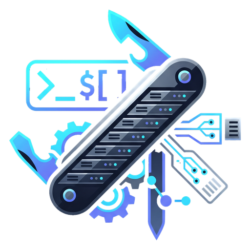
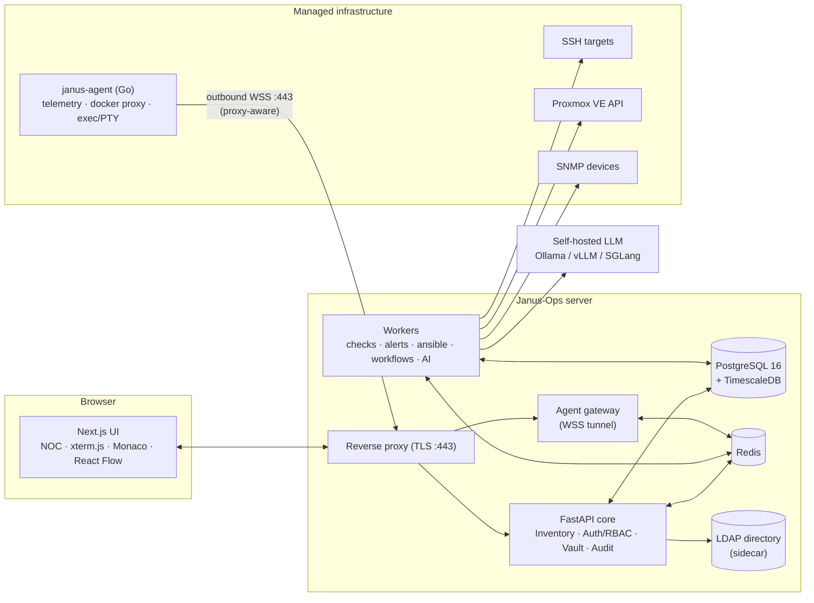
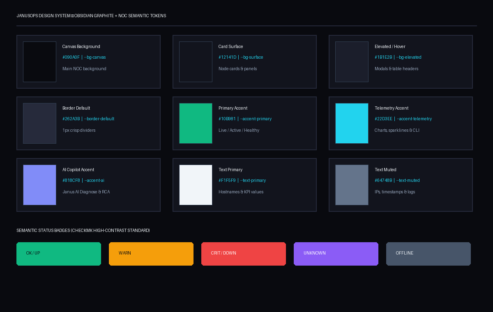

<div align="center">



# Janus-Ops

**One portal for your whole infrastructure lifecycle.**<br/>
Monitoring · Containers · Virtualization · SSH · Automation · AI troubleshooting — in a single pane of glass.


</div>

---

## Why Janus-Ops

Operating a real-world infrastructure usually means juggling half a dozen tools:
**Checkmk** for monitoring, **Portainer / Dockhand** for containers, the **Proxmox VE** web UI,
**MobaXterm / Termius** for SSH, and a terminal for **Ansible**. Every jump costs context.

Janus-Ops — named after the two-faced Roman god of gateways and transitions — puts **one central
inventory** at the core and plugs decoupled modules around it. Every host is defined once; its
capabilities (agent, SSH target, Docker host, Proxmox node, SNMP device) light up the matching tools.

It is designed from day one for **segmented, air-gapped and proxy-restricted networks**: the
`janus-agent` is a zero-dependency Go binary that only opens **outbound** connections on `443`.

## Core capabilities

| Module | What it does | Inspired by |
|---|---|---|
| 👁️ **Observability & Alerting** | High-frequency metrics, auto service discovery, `OK/WARN/CRIT/UNKNOWN` with hysteresis, ack, downtimes, flapping detection, parent/child dependencies, notification routing | Checkmk |
| 🐳 **Container & Stack Manager** | Multi-host Docker management through the agent tunnel, live logs/stats, exec shell, Compose stacks with GitOps, prune & image update checks | Dockhand / Portainer |
| 🛡️ **Virtualization** | Proxmox VE clusters: quorum, nodes, storage, VM/LXC lifecycle, snapshots, migration, console, backup & replication audit | Proxmox VE UI |
| 🔑 **SSH Bastion** | Web terminal (xterm.js), credential vault, SFTP browser, multi-tab & broadcast, snippet library, transparent ProxyJump / agent tunnel | MobaXterm / Termius |
| ⚡ **Automation Hub** | Ansible playbooks with dynamic inventory from the DB, surveys, live output; visual event-driven workflow builder | AWX / n8n |
| 🤖 **Janus AI Copilot** | One-click RCA on failing services (logs + metrics + audit trail), contextual IaC generation, **human-approved** action plans only — powered by **self-hosted** models | — |

Cross-cutting: unified inventory, encrypted secret vault, LDAP-backed login with TOTP and RBAC
(Admin / Operator / Auditor), immutable audit log with optional terminal session recording,
global command palette (`Ctrl+K`).

## Architecture at a glance



Full functional specification: [docs/specs.md](docs/specs.md) ·
Implementation plan, ADRs and roadmap: [docs/PLAN.md](docs/PLAN.md)

## Tech stack

| Layer | Technology |
|---|---|
| Backend | Python 3.12+, FastAPI, SQLAlchemy 2.0 (async), Alembic |
| Data | PostgreSQL 16 + TimescaleDB (Community Edition), Redis |
| Identity | LDAP directory as a Docker sidecar (users & groups → roles), TOTP, local break-glass admin |
| Workers | Async task queue + scheduler (see ADR in [docs/PLAN.md](docs/PLAN.md)) |
| Integrations | AsyncSSH, aiodocker / Docker Engine API, Proxmox VE REST API, pysnmp, ansible-runner |
| Frontend | Next.js (App Router), TypeScript, Tailwind CSS, shadcn/ui, TanStack Query, Zustand, ECharts, Monaco, xterm.js, React Flow |
| Agent | Go, `CGO_ENABLED=0` static builds for `linux/amd64`, `linux/arm64` (Windows later) |
| AI | OpenAI-compatible API to self-hosted models (Ollama / vLLM / SGLang), read-only tool calling |

## Design system — *Obsidian Graphite NOC*

A dark, high-density NOC theme with Checkmk-grade status contrast.



| Token | Hex | Usage |
|---|---|---|
| `--bg-canvas` | `#090A0F` | Main background |
| `--bg-surface` | `#12141D` | Cards & panels |
| `--bg-elevated` | `#1B1E2B` | Modals, table headers, hover |
| `--border-default` | `#262A3B` | 1px dividers |
| `--accent-primary` | `#10B981` | Live / active / healthy |
| `--accent-telemetry` | `#22D3EE` | Charts, sparklines, CLI |
| `--accent-ai` | `#818CF8` | Janus AI diagnose & RCA |
| `--text-primary` | `#F1F5F9` | Hostnames, KPI values |
| `--text-nav` | `#94A3B8` | Inactive navigation items |
| `--text-muted` | `#64748B` | IPs, timestamps, logs |

Status badges: **OK** `#10B981` · **WARN** `#F59E0B` · **CRIT/DOWN** `#EF4444` · **UNKNOWN** `#8B5CF6` · **OFFLINE** `#475569`.
Typography: **Inter** for UI, **JetBrains Mono** (tabular numerals) for metrics.
Logo, favicons, tokens, base CSS, reference components and the app-shell mockup live in
[`res/`](res/) — see [res/README.md](res/README.md).

## Project status & roadmap

> 🚧 **Janus-Ops is in the design phase.** There is no runnable code yet — installation
> instructions will be added together with the first deliverable.

| Phase | Scope |
|---|---|
| **F0** Foundations | Monorepo, CI, compose stack, LDAP login/RBAC, inventory, vault, audit log, UI shell & design system |
| **F1** SSH Bastion | Web terminal, vault-backed credentials, SFTP, session audit |
| **F2** Agent & Telemetry | `janus-agent` enrollment, WSS tunnel, metrics ingest, NOC dashboard |
| **F3** Alerting | Check states, hysteresis, ack/downtime, dependencies, notifications |
| **F4** Containers | Docker via agent, logs/stats/exec, Compose stacks |
| **F5** Proxmox | Cluster overview, VM/LXC lifecycle, backup audit |
| **F6** Ansible | Dynamic inventory, playbook catalog, live runs |
| **F7** AI Copilot | RCA on alerts, action plans with human approval |
| **F8+** | Visual workflows, GitOps, SNMP, agent PTY & auto-update, Windows agent |

Details, acceptance criteria and open decisions: [docs/PLAN.md](docs/PLAN.md).

## Repository layout (planned)

```
janus-ops/
├── backend/     FastAPI core + modules + workers
├── frontend/    Next.js application
├── agent/       janus-agent (Go)
├── proto/       Agent ⇄ server message contracts
├── deploy/      Docker Compose, reverse proxy, env reference
├── docs/        specs, plan, ADRs, runbooks
└── res/         Brand & design resources (logo, favicons, tokens, mockups)
```

## Security principles

- The agent **never listens** on a port; all traffic is outbound, authenticated and encrypted.
- Private keys and secrets **never reach the browser**; they are decrypted server-side only when used.
- Every privileged action (shell, restart, playbook, AI action plan) is **attributed and audited**.
- The AI Copilot runs on **self-hosted models only**, is **read-only by default**, never sees vault
  secrets and never executes destructive actions on its own.

## License

Janus-Ops is released under the [Apache License 2.0](LICENSE). See [NOTICE](NOTICE).

Janus-Ops runs on TimescaleDB Community Edition, which has its own license, the
[Timescale License (TSL)](https://www.tigerdata.com/legal/licenses). The TSL is free for self-hosted use.
