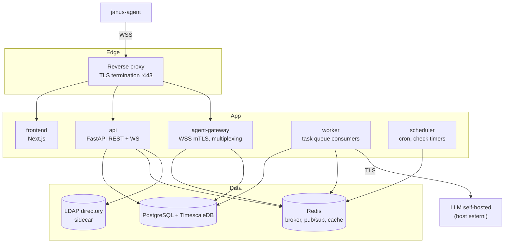

# Janus-Ops — Analisi & Piano di Implementazione

> Documento di pianificazione derivato da [specs.md](specs.md).
> Stato: **bozza v0.2 — 2026-11-13**. Le decisioni marcate `OPEN` attendono conferma.
>
> **v0.2** — integrate le risposte alle domande aperte: scala confermata (A2), LDAP come directory
> sidecar nello stack (A5 → ADR-008), Windows fuori dall'MVP (A4), AI su modelli self-hosted esterni
> con accesso a tutti i dati operativi (A6), licenza TimescaleDB verificata (C12). Aggiunta analisi del
> `janusops-design-kit/` (§8).
>
> **v0.3** — licenza **Apache-2.0** (A8), grafia del brand **Janus-Ops** (C15), favicon e varianti del
> logo generate dal master, `res/` come unica cartella degli asset di design (§8). Nessuna domanda aperta.
>
> **v0.4** — avvio F0: immagine unica `lordraw77/janus-ops` (ADR-009, AMEND ADR-006), schema DDL
> F0–F3 come migrazione Alembic `0001`, scaffold backend/frontend/deploy/CI, overview Docker Hub
> (`docs/dockerhub/`). Avanzamento in §5.1.
>
> **v0.5** — login LDAP con username e password, ruoli dai gruppi, sessioni, break-glass, audit con
> hash chain, pagina di login (AC-02, AC-02b, AC-02c verificati). Dettagli implementativi in ADR-008.
>
> **v0.6** — amministratore iniziale da `.env`; gestione utenti dalla UI (lldap via `janus-manager`);
> ruoli configurabili con permessi (ADR-010), incluso chi legge l'audit log; viewer dell'audit;
> **TOTP opzionale** per utente, funzionante dietro proxy aziendale e air-gapped.
>
> **v0.7** — inventory (nodi, tag, gruppi, capability) e vault credenziali (ADR-004 implementato):
> **fase F0 completata**, AC-01 verificato. Migrazione `0003`, permessi `inventory.*` e
> `credentials.manage`.
>
> **v0.8** — F1 avviata: bastion SSH web (xterm.js ⇄ WebSocket ⇄ AsyncSSH) con credenziali dal
> vault, jump host, pinning delle host key (TOFU), registrazione e replay delle sessioni,
> permesso `ssh.connect`, migrazione `0004`. AC-03 verificato.
>
> **v0.9** — roadmap: segreti e chiavi in un secret manager esterno (OpenBao, HashiCorp Vault o
> simili), FR-86 promosso da WON'T a SHOULD, proposta in ADR-011.
>
> **v0.10** — **fase F1 completata**: browser SFTP (FR-11), broadcast dei comandi su più terminali
> e libreria di snippet (FR-12). Migrazione `0005` (tabella `snippet`), permessi `sftp.transfer`
> (operator) e `snippets.manage` (solo admin di default). Migrazione `0006`: credenziale
> Proxmox con utente e password (`proxmox_password`, utente con realm `root@pam`), oltre al token API.
>
> **v0.11** — **fase F2**: agent Go (`agent/`, binario statico amd64/arm64), gateway WebSocket,
> enrollment con token monouso e chiave ed25519 generata sul nodo (AMEND ADR-002), bootstrap via
> SSH, telemetria con buffer su disco e ingest idempotente in TimescaleDB, dashboard NOC (esagono,
> node card, "needs attention") e pagina nodo con grafici. Migrazione `0007`, permesso
> `agents.manage` (operator). Avanzamento in §5.3.
>
> **v0.12** — **fase F3**: motore dei check (agent, metriche, systemd, porte, TCP e HTTP dal server)
> con isteresi, stati soft/hard e flapping; problemi, ack, downtime, dipendenze padre/figlio;
> notifiche e-mail (SMTP con o senza login), Telegram, webhook firmato, Discord, Slack, ntfy;
> discovery dei check. Migrazione `0008`, permessi `monitoring.manage` (operator) e
> `notifications.manage` (admin). Avanzamento in §5.4.
>
> **v0.13** — **fase F4**: container Docker via tunnel dell'agent (stream multiplexati, policy
> locale `allow_docker`) o via SSH (inoltro del socket Unix); elenco, stack Compose, inspect,
> log in diretta, statistiche, azioni, exec nel browser. Migrazione `0009`, permessi
> `containers.manage` e `containers.exec` (operator). Avanzamento in §5.5. La vista Containers è
> una tabella (stato, salute, uptime, riavvii, CPU, memoria, rete, disco, IP, porte
> pubblicate, stack) con ricerca, filtri e ordinamento.
>
> **v0.14** — **fase F5**: Proxmox VE. Client async httpx (ADR C4: Proxmoxer non serve), ticket o
> token API dal vault, cluster raggruppati con failover tra i membri, panoramica nodi/storage/VM/LXC,
> ciclo di vita, snapshot, clone, migrazione, task con log, audit dei backup vzdump/PBS e console
> xterm.js via termproxy. Migrazione `0010`, permessi `proxmox.manage` e `proxmox.console`
> (operator). Avanzamento in §5.6.
>
> **v0.15** — **ambienti configurabili e ambito dei nodi per ruolo**. Gli ambienti sono una
> tabella (non più un vincolo fisso): CRUD per gli admin (`environments.manage`). Ogni ruolo vede
> tutti i nodi oppure solo quelli che soddisfano almeno una regola; una regola combina in AND
> ambiente, tag, gruppo, capability e nodi specifici; più ruoli si sommano. Applicato a inventory,
> check, problemi, downtime, dashboard, agent, terminale, SFTP, container, Proxmox e storico delle
> sessioni; i nodi fuori ambito rispondono 404. Migrazione `0011`. Dettagli in §5.7.
>
> **v0.16** — **F6 — catalogo playbook da più sorgenti**: oltre a Git, i playbook possono arrivare
> da upload di un file locale, da un editor incorporato nella UI, da una mount di rete (NFS/SMB)
> o da un host remoto via SFTP/SCP. Ogni sorgente è registrata con il suo tipo; le sorgenti remote
> usano credenziali dal vault (ADR-004). Le sorgenti sono lette in sola lettura, tranne l'editor e
> l'upload che scrivono nel catalogo interno. Ulteriori dettagli in §5.8 (decisioni F6).
> In questa versione chiuso in F5 l'alert dai backup verso il motore F3 (check `backup`); resta
> aperto il collaudo con un PBS reale.
>
> **v0.17** — **fase F6 avviata**: backend del catalogo playbook (migrazione `0012`, permessi
> `ansible.read`, `ansible.manage`, `ansible.run`). Sorgenti git, upload, editor e mount di rete
> (solo directory elencate in `JANUS_ANSIBLE_MOUNT_ROOTS`); file versionati, diff, run con
> storico congelato, UI in console. Avanzamento in §5.9.
>
> **v0.18** — **fase F6 completata** (con verifiche parziali, vedi §5.9): password SSH, jump host
> (un salto, solo chiave), survey dei playbook (`<nome>.survey.json`, valori congelati nel run),
> sorgente SFTP in sola lettura con host key TOFU, test d'integrazione dedicati. Migrazione `0013`.
>
> **v0.19** — **fase F7 avviata** (ADR-007): Copilot su endpoint OpenAI-compatible self-hosted (https),
> tool read-only (inventory, metriche, storico check, audit del nodo), diagnosi asincrona su un
> problem aperto, action plan approvabile o modificabile (`ai.use`, `ai.approve`). Migrazione `0014`.
> Avanzamento in §5.10.
>
> **v0.20** — **fase F8 avviata** (§5.11): exec via agent con policy locale `allow_exec` e esecuzione delle
> azioni approvate del Copilot (`actions.execute`), audit di ogni tentativo. Allineati stato, README e
> STATE alle fasi F0–F7 già completate.
>
> **v0.21** — **F8, GitOps compose** (FR-81, backend): stack da repository https, deploy via agent, webhook firmato, storico dei run, permessi `gitops.manage` e `gitops.deploy`. Migrazione `0015`. Interfaccia web e workflow ancora da fare. Dettagli in §5.11.
>
> **v0.22** — **F8, SNMP v2c/v3** (FR-82): check `snmp` (una lettura GET di un OID numerico dal server,
> soglie e stati come gli altri check), capability `snmp` con versione, porta, livello di sicurezza e
> algoritmi v3; credenziali `generic` (community) e `snmp_v3` (utente e passphrase nel vault). Dipendenza
> `pysnmp` (ADR-012). Nessuna migrazione per SNMP.
>
> **v0.23** — **catalogo degli OID SNMP** (migrazione `0016`): tabella `snmp_oid` con le voci della guida
> Synology DiskStation MIB (sistema, dischi, RAID, UPS). Nel form dei check si sceglie un nome dal catalogo;
> per le colonne di tabella (dischi, pool) si indica il numero dell'istanza. Le voci si aggiungono e si
> segnano come verificate dalla UI. Lettura con `inventory.read`, modifica con `monitoring.manage`, audit
> di ogni modifica. Dettagli in §5.11.
>
> **v0.25** — **F8, workflow** (FR-80, migrazione `0021`): definizioni con trigger manuale, a intervallo e
> alert; passi exec (via agent), notify (verso un canale di notifica) e approval; approvazioni con rifiuto; i passi fatti non si ripetono.
> Esecuzione in background con scheduler di 30 secondi. Dettagli in §5.11.
>
> **v0.24** — **SNMP: discovery, tipi di dispositivo, template di check** (migrazioni `0017`, `0018`).
> Discovery di un nodo SNMP in sola lettura (GETNEXT sotto le radici scelte, al massimo tre, solo
> sotto `1.3.6.1`, 500 risposte e 60 secondi per radice): i candidati si selezionano e solo allora
> entrano nel catalogo. Ogni voce del catalogo ha un tipo di dispositivo (nas, ups, switch, router,
> server, generic). Template di check preconfigurati (`snmp_template`): un NAS Synology di base e un
> UPS di base; applicarne uno crea i check sul nodo, un check per istanza per le voci di tabella
> (dischi, pool), e salta i check già presenti.

**Tier: L** — sistema multi-servizio (backend, worker, frontend, agent Go), integrazioni esterne
(SSH, Docker, Proxmox, SNMP, LLM), requisiti di sicurezza elevati (esecuzione remota di comandi).

---

## ASSUMPTIONS

Ogni assunzione è versionata. Se viene invalidata, la colonna "Impatta" indica cosa rivedere.

| ID | Assunzione | Impatta |
|---|---|---|
| A1 | Deploy **self-hosted, single-tenant** (una organizzazione per installazione) | Data model, RBAC, ADR-001 |
| A2 | ✅ *confermata "per il momento"* — Scala MVP: **≤ 500 nodi**, **≤ 20 utenti concorrenti**, un singolo server Janus-Ops (no HA nell'MVP) | ADR-002, ADR-005, sizing Timescale |
| A3 | Runtime target: **Docker Compose** su un host Linux; k8s non nell'MVP | DevOps, deploy/ |
| A4 | ✅ *confermata* — Agent MVP solo **Linux amd64/arm64** con systemd; Windows e OpenRC rimandati a F8+ | Agent, bootstrap |
| A5 | ✅ *rivista v0.2* — Autenticazione MVP: **directory LDAP come container sidecar nello stack** (utenti e gruppi), ruoli Janus mappati sui gruppi LDAP, **TOTP gestito da Janus-Ops, opzionale per utente** (*rivista v0.6*), un account locale *break-glass* per l'emergenza. Collegamento ad AD/LDAP aziendale esterno: SHOULD successivo. Vedi ADR-008 | Auth, F0, deploy |
| A6 | ✅ *rivista v0.2* — LLM: modelli **self-hosted su host esterni allo stack** (Ollama / vLLM / SGLang), endpoint OpenAI-compatible configurabile; **nessun provider cloud**. All'AI è consentito l'accesso a **tutti i dati operativi** (log, metriche, audit, inventory). Restano esclusi solo i segreti del vault | AI, sicurezza |
| A7 | Il server Janus-Ops può raggiungere direttamente (o via jump host) le API Proxmox e gli host SSH | F1, F5 |
| A8 | ✅ *decisa v0.3* — Janus-Ops è rilasciato sotto **Apache-2.0** (`LICENSE`, `NOTICE`). Le dipendenze devono avere una licenza compatibile; per TimescaleDB vedi C12. Ansible (GPLv3) è invocato come processo esterno via ansible-runner (Apache-2.0), non incluso nel codice di Janus-Ops | Supply chain |

---

## 1. Analisi critica delle specifiche

Punti delle specifiche che vanno corretti, chiariti o ridimensionati prima di scrivere codice.

| # | Punto in specs.md | Problema | Proposta |
|---|---|---|---|
| C1 | Scope generale (8 moduli) | Equivale a ricostruire Checkmk + Portainer + PVE UI + Termius + AWX + n8n + Copilot. Senza fasi rigide il progetto non arriva mai a un MVP utilizzabile. | Roadmap a fasi incrementali, ognuna rilasciabile (§5). Ogni modulo parte con un sottoinsieme MUST. |
| C2 | Agent: "gRPC over HTTP/2 **o** WebSocket" | Due protocolli = doppio costo. gRPC/HTTP2 viene spesso rotto dai proxy aziendali con TLS inspection. | **Solo WSS** su 443 con multiplexing di stream (ADR-002). |
| C3 | Scheduler: "Taskiq / Celery" + workflow "Temporal o Celery Canvas" | Tre motori candidati per due esigenze. Temporal aggiunge un cluster da gestire. Celery non è nativo async. | Un solo motore async per task + workflow engine interno persistito su Postgres (ADR-003). Temporal rivalutato solo se servono workflow di lunga durata complessi. |
| C4 | "Proxmoxer (wrapper Python **asincrono**)" | Proxmoxer è sincrono `[VERIFY: supporto async nelle versioni correnti]`. | Client HTTP async (httpx) sottile sulle API REST PVE, oppure proxmoxer in thread pool. Decisione in F5. |
| C5 | Docker "via tunnel agent **oppure** `ssh://`" con aiodocker | aiodocker non gestisce `ssh://` nativamente `[VERIFY]`. | L'agent espone la Docker Engine API come stream nel tunnel; il backend parla HTTP Docker su quello stream. `ssh://` solo come fallback futuro. |
| C6 | Proxy con autenticazione **NTLM** | Non supportato dalla stdlib Go; richiede libreria terza `[VERIFY: libreria mantenuta]`. | MVP: proxy senza auth + Basic + CA custom. NTLM come SHOULD in fase successiva. |
| C7 | Agent: token + certificato CA | Un token statico in chiaro su disco è il solo segreto di autenticazione. | Enrollment con token **monouso** → emissione certificato client per agent (**mTLS**), rotazione periodica. |
| C8 | Auto-update agent | Distribuire binari a tutta la flotta è un vettore di compromissione di massa. | Binari **firmati** (ed25519) con chiave di release separata dal server; l'agent verifica firma e checksum prima di sostituirsi. |
| C9 | "Remote Command / Task Executor" nell'agent | Di fatto RCE by design: il server Janus-Ops diventa il bersaglio più critico dell'infrastruttura. | Policy locale sull'agent (`allow_exec`, `allow_pty`, `allow_docker`) che il server non può sovrascrivere; tutto auditato. |
| C10 | AI RCA su log | I log sono input non fidato → **prompt injection** (un log può contenere istruzioni). | Tool AI read-only; output mai eseguito senza approvazione; i segreti del vault non sono mai esposti ai tool AI; traffico verso gli endpoint LLM esterni solo su TLS (A6). |
| C11 | "Audit Log Immutabile" | Una tabella SQL non è immutabile per un admin DB. | Append-only (no UPDATE/DELETE via grant) + hash chain per evidenziare manomissioni; export esterno opzionale. |
| C12 | TimescaleDB | ✅ *verificato v0.2*: due edizioni. **Apache 2 Edition** (core, hypertable) e **Community Edition** sotto **Timescale License (TSL)**, che include compressione e continuous aggregates. La TSL è gratuita per uso self-hosted, anche commerciale; vieta di offrire TimescaleDB come servizio database gestito. | Usare la Community Edition (immagine ufficiale), che è il default (`SHOW timescaledb.license;` → `timescale`). Janus-Ops usa il DB via SQL senza modificarne il codice e non lo vende come DBaaS, quindi la TSL non vincola la licenza di Janus-Ops. |
| C13 | Next.js "15" | Versione da verificare al momento del bootstrap `[VERIFY: ultima stable]`. Tailwind: i file in `res/` usano `@import "tailwindcss"` → **Tailwind v4**. | Fissare le versioni in F0. |
| C14 | File in `res/` | ✅ *risolto v0.2*: i file sono stati rinominati. | — |
| C15 | Nome del brand | ✅ *risolto v0.3*: grafia ufficiale **Janus-Ops**. Nel wordmark della UI: "Janus-" in `--text-primary`, "Ops" in `--accent-primary`. Per identificatori tecnici: `janus-ops` / `janus-agent`. | — |

---

## 2. Product Owner — Requisiti

### 2.1 Requisiti funzionali (MVP = F0–F3, poi per fase)

| ID | Requisito | Priorità | Fase |
|---|---|---|---|
| FR-01 | Inventory unificato di nodi con tag, gruppi, ambiente (`prod/lab/dmz`) e capability attivabili | MUST | F0 |
| FR-02 | Vault cifrato per chiavi SSH, password sudo, token API | MUST | F0 |
| FR-03 | Login con utenti della directory LDAP sidecar, ruoli mappati sui gruppi LDAP. **AMEND Product Owner (v0.6)**: TOTP **opzionale** per utente (era obbligatorio), su richiesta dell'utente | MUST | F0 |
| FR-08 | Amministratore iniziale creato da `.env` al primo avvio, solo se assente | MUST | F0 |
| FR-09 | Gestione utenti dalla UI: crea, modifica, ruoli, disabilita, reset password, reset 2FA, elimina | MUST | F0 |
| FR-10b | Ruoli configurabili: gruppo LDAP + insieme di permessi; ruoli custom; chi legge l'audit log è un permesso (`audit.read`) | MUST | F0 |
| FR-11b | TOTP funzionante senza accesso a internet (proxy aziendali, air-gapped) | MUST | F0 |
| FR-06 | Account locale *break-glass*, usabile anche con LDAP non disponibile, ogni uso segnalato nell'audit | MUST | F0 |
| FR-07 | Collegamento opzionale ad AD/LDAP aziendale esterno al posto del sidecar | SHOULD | F8 |
| FR-04 | Audit log di ogni azione privilegiata, consultabile e filtrabile | MUST | F0 |
| FR-05 | Command palette `Ctrl+K` per navigare su nodi e azioni | SHOULD | F0 |
| FR-10 | Sessione SSH web 1-click su un nodo, con credenziali dal vault | MUST | F1 |
| FR-11 | Multi-tab / split, SFTP browser, upload/download | SHOULD | F1 |
| FR-12 | Broadcast comando su più terminali, snippet library | SHOULD | F1 |
| FR-13 | Registrazione sessione (asciinema) | SHOULD | F1 |
| FR-14 | ProxyJump tramite jump host | SHOULD | F1 |
| FR-20 | Bootstrap agent via SSH (detect arch, copia binario, config, systemd) | MUST | F2 |
| FR-21 | Agent connesso in uscita via WSS, proxy HTTP(S) con CA custom | MUST | F2 |
| FR-22 | Telemetria ogni 5–15 s: CPU, RAM/swap, disk I/O, filesystem, unit systemd, porte, top processi | MUST | F2 |
| FR-23 | Buffer locale su disco durante disconnessione e invio differito | MUST | F2 |
| FR-24 | NOC dashboard: hexagon widget, node cards, tabella unhandled problems | MUST | F2 |
| FR-30 | Stati OK/WARN/CRIT/UNKNOWN con soglie e isteresi (N cicli) | MUST | F3 |
| FR-31 | Acknowledge, scheduled downtime | MUST | F3 |
| FR-32 | Dipendenze parent/child con soppressione alert figli | MUST | F3 |
| FR-33 | Flapping detection | SHOULD | F3 |
| FR-34 | Notifiche Telegram, Webhook, Email; Slack/Discord | MUST (primi 3) / SHOULD | F3 |
| FR-35 | Service discovery automatico con proposta check | SHOULD | F3 |
| FR-40 | Docker: lista container per host, start/stop/restart/kill, inspect, log streaming, stats | MUST | F4 |
| FR-41 | Exec shell nel container dal browser | MUST | F4 |
| FR-42 | Compose stack: editor YAML, `.env` cifrati, deploy/redeploy | SHOULD | F4 |
| FR-43 | Volumi, reti, prune selettivo, check aggiornamenti immagini | SHOULD | F4 |
| FR-50 | Proxmox: stato cluster/quorum, nodi, storage | MUST | F5 |
| FR-51 | VM/LXC: start/shutdown/reboot/snapshot/clone/migrazione | MUST | F5 |
| FR-52 | Console VM/LXC (xterm.js seriale; noVNC) | SHOULD | F5 |
| FR-53 | Audit backup vzdump/PBS: mancanti, falliti, troppo vecchi | MUST | F5 |
| FR-60 | Inventory Ansible dinamico dal DB | MUST | F6 |
| FR-61 | Catalogo playbook da più sorgenti: Git, upload da file locale, editor incorporato, mount di rete (NFS/SMB), SFTP/SCP; survey, esecuzione con output live, storico | MUST | F6 |
| FR-70 | AI "Diagnose" su servizio CRIT: raccolta log/metriche/audit → diagnosi + action plan | MUST | F7 |
| FR-71 | Action plan approvabile/modificabile prima dell'esecuzione | MUST | F7 |
| FR-72 | Generatore IaC contestuale | SHOULD | F7 |
| FR-80 | Workflow visuale (trigger cron/webhook/manuale/alert; azioni SSH/Ansible/Docker/Proxmox/AI/approvazione/notifica) | SHOULD | F8 |
| FR-81 | GitOps compose con webhook auto-deploy | SHOULD | F8 |
| FR-82 | SNMP (v2c/v3) per NAS, switch, UPS | SHOULD | F8 |
| FR-83 | PTY e comandi remoti via tunnel agent | SHOULD | F8 |
| FR-84 | Auto-update agent air-gapped firmato | SHOULD | F8 |
| FR-85 | Agent Windows | WON'T (MVP) | F9+ |
| FR-86 | Segreti e chiavi in un secret manager esterno (OpenBao, HashiCorp Vault o simili): chiave master (KEK) e/o contenuto dei segreti fuori da Janus-Ops. **AMEND Product Owner (v0.9)**: da WON'T a SHOULD, su richiesta dell'utente; disegno in ADR-011 | SHOULD | F8+ |
| FR-87 | Multi-tenancy, HA del server | WON'T (MVP) | — |

### 2.2 Requisiti non funzionali

| ID | Requisito | Verifica |
|---|---|---|
| NFR-01 | Agent: singolo binario statico, nessuna dipendenza runtime, nessuna porta in ascolto | `ldd` → "not a dynamic executable"; `ss -ltnp` sul nodo non mostra l'agent |
| NFR-02 | Agent funzionante dietro proxy HTTP(S) con CA custom | Test E2E con proxy (es. squid) in compose di test |
| NFR-03 | Nessuna perdita di metriche per disconnessioni ≤ 1 h | Test: disconnessione 60 min → gap assente nei dati |
| NFR-04 | Latenza ingest → stato in dashboard ≤ 30 s (p95) | Misura end-to-end in test di carico |
| NFR-05 | Ingest sostenuto per 500 nodi a 10 s (~10k punti/s stimati) | Test di carico sintetico |
| NFR-06 | Segreti mai inviati al browser, mai nei log | Test automatici su response/log + review |
| NFR-07 | Ogni azione privilegiata produce un evento di audit attribuito | Test per ogni endpoint mutante |
| NFR-08 | Installazione da clone pulito con soli comandi documentati | Job CI "fresh install" |
| NFR-09 | UI usabile ≥ 1280 px; dashboard leggibile a 1920 px (NOC wall) | Review visuale / Playwright screenshot |

### 2.3 Criteri di accettazione MVP (estratto)

| ID | Criterio (osservabile dall'esterno) | Metodo |
|---|---|---|
| AC-01 | Un Operator aggiunge un host con IP + credenziale SSH e vede la capability "SSH Target" attiva | E2E Playwright |
| AC-02 | Un Auditor non può aprire shell né modificare nodi (HTTP 403, pulsanti assenti) | API test + E2E |
| AC-02b | Un utente aggiunto al gruppo LDAP `janus-operators` ottiene il ruolo Operator al login successivo; rimosso dal gruppo, lo perde | Integration test con container LDAP |
| AC-02c | Con il container LDAP fermo, solo l'account break-glass può accedere e l'evento compare nell'audit | Integration test |
| AC-03 | Aprendo una shell, l'audit log registra utente, nodo, timestamp inizio/fine | API test |
| AC-04 | Bootstrap agent su Debian e Rocky (amd64/arm64): l'host diventa "online" entro 60 s | E2E su VM/container di test |
| AC-05 | Bloccando l'uscita per 10 min, al ripristino la serie temporale è continua | Integration test |
| AC-06 | CPU > soglia CRIT per 3 cicli → stato CRIT e notifica webhook; per 2 cicli → nessun alert | Integration test |
| AC-07 | Con nodo padre DOWN, i figli sono "UNREACHABLE" e non generano notifiche | Integration test |
| AC-08 | In downtime programmato nessuna notifica viene inviata | Integration test |

---

## 3. Architect — Componenti, flussi, ADR

### 3.1 Componenti



| Componente | Responsabilità | Requisiti coperti |
|---|---|---|
| reverse proxy | TLS, routing per path, unico ingresso :443 | NFR-01, NFR-02 |
| frontend | UI, stato real-time via WS | FR-05, FR-24, tutte le viste |
| api | Auth, RBAC, inventory, vault, audit, REST, WS verso browser, SSH bastion | FR-01..14, FR-40..72 (lato API) |
| agent-gateway | Terminazione tunnel agent, enrollment, routing stream (docker/exec/pty), ingest metriche in batch | FR-20..23, FR-40, FR-83 |
| worker | Valutazione check, alerting, notifiche, Ansible, Proxmox, AI, workflow | FR-30..35, FR-50..53, FR-60..80 |
| scheduler | Timer di check, cron workflow, retention | FR-30, FR-80 |
| ldap (sidecar) | Directory utenti e gruppi; raggiungibile solo sulla rete interna del compose | FR-03, FR-06 |
| janus-agent | Telemetria, docker proxy, exec/PTY, buffer, update | FR-20..23, FR-83, FR-84 |

`agent-gateway` nell'MVP può essere un modulo dello stesso processo `api`; resta separabile
perché comunica solo via Redis/PG (scalabilità oltre A2).

### 3.2 Struttura del repository

Stato attuale (v0.4). Le cartelle marcate *(F…)* arrivano con la fase indicata.

```
janus-ops/
├── backend/
│   ├── pyproject.toml, uv.lock     dipendenze pinnate (uv)
│   ├── src/janus_ops/
│   │   ├── cli.py                  janus-ops serve | migrate | version
│   │   ├── config.py               Settings da variabili JANUS_*
│   │   ├── db.py, health.py        engine async, /health, /ready
│   │   ├── main.py                 app factory, header di sicurezza, UI statica
│   │   ├── logsetup.py             log JSON su stdout
│   │   ├── migrations/             Alembic (SQL scritto a mano, niente autogenerate)
│   │   └── modules/  (F0+)         auth, inventory, vault, audit, ssh, monitoring, ...
│   └── tests/                      unit + integration (TimescaleDB reale)
├── frontend/
│   ├── app/, components/           App Router, Sidebar, StatusBadge
│   └── scripts/sync-assets.mjs     copia icone e logo da res/ in public/
├── agent/  (F2)                    janus-agent in Go
├── proto/  (F2)                    contratti agent ⇄ server
├── deploy/                         compose.yaml, compose.build.yaml, Caddyfile, .env.example
├── scripts/                        gen-env.sh, integration-test.sh, release.sh
├── docs/                           specs, PLAN, dockerhub/
├── res/                            brand & design resources
├── Dockerfile, .dockerignore       immagine unica (ADR-009)
├── .github/workflows/ci.yml        lint, test, integration, build; push su tag v*
└── Makefile
```

### 3.3 ADR

**ADR-001 — Monorepo**
- *Opzioni*: (a) monorepo unico — versionamento atomico dei contratti agent⇄server, CI unica; (b) repo separati — release indipendenti, ma contratti duplicati e drift.
- *Decisione*: **(a)**. I contratti `proto/` devono cambiare insieme ad agent e gateway.
- *Conseguenze*: CI con job per linguaggio filtrati per path.

**ADR-002 — Trasporto agent: WSS + multiplexing**
- *Opzioni*: (a) gRPC bidi su HTTP/2 — tipizzato, ma fragile con proxy TLS-inspecting e alcuni L7 LB; (b) WebSocket su HTTP/1.1 Upgrade + multiplexer di stream (es. yamux `[VERIFY: libreria]`) + messaggi protobuf — massima compatibilità con proxy; (c) SSH reverse tunnel — maturo ma porta 22 spesso bloccata e gestione chiavi più complessa.
- *Decisione*: **(b)**. Un canale di controllo + stream dedicati per metriche, docker, exec, PTY.
- *Conseguenze*: si implementano a mano heartbeat, backpressure e reconnect (backoff esponenziale con jitter). Autenticazione mTLS (cert per-agent da enrollment, vedi C7). Se un proxy TLS-inspecting rompe l'mTLS: fallback a token firmato a breve scadenza dentro il tunnel `OPEN`.
- **AMEND Architect (v0.11)**: implementato in F2 con tre scostamenti, contratto in [`proto/agent-protocol.md`](../proto/agent-protocol.md).
  1. *Autenticazione*: il fallback diventa la soluzione principale. L'agent genera sul nodo una chiave ed25519 (non lascia mai il nodo); a ogni connessione firma un nonce casuale del server legato a node id e host del server. Il token monouso del bootstrap registra la chiave (solo hash SHA-256 in DB, TTL 15 min, invalidato da un nuovo bootstrap). Motivi: il TLS è terminato da Caddy (ADR-009), quindi un certificato client non arriverebbe all'app senza una seconda porta e header fidati; funziona sulla 443 dietro proxy che ispezionano il TLS; nessuna CA da gestire o ruotare. Rischio residuo: chi intercetta il TLS (CA fidata dall'agent) e inoltra il challenge in tempo reale può impersonare l'agent per quella connessione, come con qualunque bearer; non può riusare la firma altrove né più tardi. Revoca = rifiuto della chiave (`revoked_at`).
  2. *Codifica*: messaggi JSON (campo `t`) invece di protobuf: volumi bassi (≤ 500 nodi ogni 10 s), leggibili nei log, nessun codegen in due linguaggi; il campo `v` permette di cambiare codifica.
  3. *Multiplexing*: rimandato a F4, quando serviranno gli stream Docker; in F2 c'è un solo canale. Sarà fatto con frame binari con id di stream sopra lo stesso WebSocket (yamux `[VERIFY]` non serve).

**ADR-003 — Task queue e workflow**
- *Opzioni*: (a) Celery + Canvas — maturo, ma sync-first e Canvas poco adatto a workflow con attese umane; (b) Taskiq (async) + workflow engine interno (DAG persistito in PG, step idempotenti) — coerente con FastAPI async, stato ispezionabile in SQL; (c) Temporal — durabilità eccellente, ma un servizio pesante in più da operare.
- *Decisione*: **(b)** `[VERIFY: maturità Taskiq al bootstrap; alternativa equivalente: arq]`.
- *Conseguenze*: l'engine workflow (F8) va progettato con stati espliciti (pending/running/waiting_approval/failed/done) e retry idempotenti.

**ADR-004 — Secret vault**
- *Opzioni*: (a) cifratura applicativa AES-256-GCM con envelope encryption (DEK per segreto, KEK da master key in env/file) — nessuna dipendenza; (b) OpenBao/Vault esterno — più robusto ma un servizio in più; (c) pgcrypto — chiave visibile al DB.
- *Decisione*: **(a)** dietro un'interfaccia `SecretBackend`, così (b) diventa un'implementazione aggiuntiva (FR-86).
- *Conseguenze*: procedura di rotazione KEK documentata; la master key non va mai nel DB né nei backup DB.
- *Implementazione (v0.7)*: KEK = `JANUS_SECRET_KEY`; una DEK casuale per credenziale; segreto e DEK cifrati AES-256-GCM con AAD legata all'id della credenziale (righe non scambiabili); `kek_version` per la futura rotazione della KEK (solo re-wrap delle DEK). Segreti in sola scrittura via API; `reveal()` riservato ai moduli che li useranno (F1+). Chiavi SSH validate al salvataggio (OpenSSH/PEM, passphrase via `cryptography[ssh]`/bcrypt), con tipo e fingerprint salvati in `public_info`. Rotazione della KEK: non ancora implementata `OPEN`.

**ADR-005 — Storage metriche**
- *Opzioni*: (a) TimescaleDB nello stesso Postgres — un solo DB, SQL e JOIN con inventory; (b) Prometheus/VictoriaMetrics — ottimi per metriche, ma secondo sistema e modello dati separato.
- *Decisione*: **(a)** con hypertable, compressione dopo 7 giorni, continuous aggregates 1m/1h, retention raw 30 giorni `OPEN` (vedi C12).
- *Conseguenze*: ingest in batch (COPY / insert multi-riga) dal gateway; schema metriche "narrow" (`time, node_id, metric_id, value`) + tabella `metric_series` per le label.

**ADR-006 — Frontend e sessione**
- *Opzioni*: (a) Next.js come SPA prevalentemente client-side, API FastAPI stessa origine via reverse proxy, sessione in cookie httpOnly; (b) Next.js come BFF con proxy delle API — più codice, doppia auth.
- *Decisione*: **(a)**. Niente segreti né logica di autorizzazione nel layer Next.
- *Conseguenze*: CSRF token per richieste mutanti; WebSocket autenticati con lo stesso cookie + verifica Origin.
- **AMEND Architect (v0.4)**: il frontend è compilato con `output: 'export'` (file statici) e servito dal processo FastAPI, non da un server Next.js — per permettere l'immagine unica (ADR-009). Conseguenze: niente SSR, Server Actions né rotte dinamiche senza `generateStaticParams`; le pagine di dettaglio useranno parametri in query string o routing client-side. Nessun requisito ne dipende, perché con (a) tutto il rendering era già lato client.

**ADR-009 — Packaging: immagine unica**
- *Contesto*: un solo repository Docker Hub (`lordraw77/janus-ops`) e un deploy semplice per ambienti air-gapped.
- *Opzioni*: (a) **immagine unica**: API + UI esportata, stessa immagine anche per `migrate` e per i futuri worker (comando diverso) — un artefatto, una versione; (b) immagini separate `-api` e `-frontend` — scalano separatamente, ma due repository e un container Node in più senza benefici, dato che l'UI non fa SSR.
- *Decisione*: **(a)**. Build multi-stage: Node 24 per l'export della UI → uv per il virtualenv → runtime `python:3.12-slim`, utente non-root `10001`.
- *Conseguenze*: TLS fuori dall'immagine (Caddy nella stack di riferimento); i ruoli futuri (worker, scheduler, agent-gateway) saranno sottocomandi di `janus-ops` sulla stessa immagine; i binari dell'agent (F2) potranno essere inclusi nell'immagine per l'auto-update air-gapped.

**ADR-010 — Ruoli e permessi configurabili (v0.6)**
- *Contesto*: l'utente chiede che l'accesso all'audit log (e in generale ai moduli) sia configurabile dalla gestione utenti.
- *Opzioni*: (a) ruoli fissi in codice (stato v0.5) — semplice ma ogni cambio richiede un rilascio; (b) **permessi definiti nel codice, ruoli nel database** — ogni ruolo = gruppo LDAP + insieme di permessi, modificabili dalla UI; (c) policy engine (es. OPA/Casbin) — potente ma sproporzionato per l'MVP.
- *Decisione*: **(b)**. Catalogo permessi in `rbac.py` (`audit.read`, `users.read`, `users.manage`, `roles.manage`; cresce con i moduli). Ruoli built-in `admin` (tutti i permessi, non modificabile), `operator`, `auditor`; ruoli custom creabili. Più ruoli = unione dei permessi.
- *Conseguenze*: la sessione salva i ruoli al login; i permessi sono ricalcolati a ogni richiesta, quindi una modifica vale subito anche per chi è collegato. Anti-escalation: solo un admin può assegnare/togliere il ruolo admin o agire su un admin; nessuno può eliminarsi, disabilitarsi o togliersi admin. Chi ha `roles.manage` può però darsi altri permessi: per questo di default ce l'ha solo admin. `JANUS_LDAP_GROUP_*` rimossi (AMEND ADR-008).

**ADR-011 — Secret manager esterno: OpenBao / HashiCorp Vault (proposta, v0.9)**
- *Contesto*: oggi (ADR-004) i segreti sono cifrati nel database con una chiave master (`JANUS_SECRET_KEY`) che sta nel file `.env`. L'utente chiede di poter tenere segreti e chiavi in un secret manager dedicato, come già fanno molte organizzazioni.
- *Opzioni*:
  (a) **KEK esterna** — il motore *Transit* di OpenBao/Vault cifra e decifra le chiavi dei singoli segreti (DEK); i segreti restano cifrati in Postgres. La chiave master non esce mai dal secret manager e non serve più in `.env`; la rotazione è quella di Transit (`rotate` + `rewrap`). Cambio minimo al modello attuale.
  (b) **Segreti esterni** — il contenuto del segreto vive nel motore *KV v2* (es. `janus-ops/credentials/<id>`); Postgres tiene solo metadati e riferimento (mount, path, versione). Permette anche credenziali "a riferimento" verso segreti già gestiti da altri team, in sola lettura.
  (c) restare solo sul vault locale — nessuna dipendenza, ma la chiave master resta un file da proteggere a mano.
- *Decisione proposta*: **(a) e (b) entrambe disponibili, (c) resta il default**, selezionabili con `JANUS_SECRET_BACKEND=local|openbao-transit|openbao-kv` dietro l'interfaccia `SecretBackend` già prevista da ADR-004 (l'attuale classe `Vault` ne diventa l'implementazione `local`). Prima (a), più semplice e già sufficiente a togliere la chiave master da `.env`; poi (b).
- *Prodotti*: **OpenBao** (fork di Vault della Linux Foundation, licenza MPL-2.0, compatibile con Apache-2.0) come riferimento e unico candidato a un eventuale sidecar nella stack; **HashiCorp Vault** con la stessa API (licenza BSL 1.1 dal 2023: utilizzabile dall'utente come servizio esterno, non distribuibile da noi nella stack); altri prodotti (Infisical, CyberArk Conjur, KMS cloud) tramite la stessa interfaccia, i KMS cloud solo dove non serve funzionare air-gapped.
- *Accesso di Janus-Ops al secret manager*: AppRole (`role_id` + `secret_id` da file o variabile), token rinnovati automaticamente, TLS con CA configurabile, policy minime (solo `encrypt`/`decrypt` sulla chiave Transit; solo il prefisso `janus-ops/` su KV).
- *Ambito*: credenziali del vault, seed TOTP, e in seguito la chiave privata della CA degli agent (F2) e i segreti delle notifiche (F3).
- *Migrazione*: comando `janus-ops secrets migrate --to <backend>` che sposta o ricifra tutte le credenziali esistenti, idempotente e registrato nell'audit; ritorno indietro con lo stesso comando.
- *Conseguenze*: il secret manager diventa una dipendenza di runtime: se non risponde, SSH e tutto ciò che usa credenziali falliscono con `vault_unavailable` (il login no, se il TOTP non è attivo). Nessuna cache del testo in chiaro; eventuale cache in memoria delle DEK decifrate per pochi minuti `OPEN`. Un OpenBao in produzione richiede gestione dell'unseal e backup propri: documentarlo; la modalità "dev" non è ammessa. `[VERIFY: client Python (hvac o HTTP diretto) e parità dell'API Transit/KV tra OpenBao e Vault]`

**ADR-012 — Client SNMP (F8, FR-82)**
- *Contesto*: NAS, switch e UPS si leggono via SNMP. Serve un client che parli v2c e v3 con autenticazione e cifratura.
- *Opzioni*: (a) **pysnmp** (lextudio, BSD): puro Python, asyncio, USM v3 completo; l'unica dipendenza transitiva è `pyasn1`, già nel lockfile; (b) `net-snmp` (`snmpget`) come binario nell'immagine: funziona, ma è un processo per lettura, parsing testuale dell'output e gestione delle chiavi v3 sulla riga di comando (la passphrase finirebbe negli argomenti del processo); (c) implementazione propria di BER e USM: nessuna dipendenza, ma crittografia e parsing scritti a mano su un protocollo che parse male è un rischio inaccettabile.
- *Decisione*: **(a)**, `pysnmp>=7.1.33` (una riga di giustificazione in `backend/pyproject.toml`). Dipendenza da tenere: senza, FR-82 non è realizzabile senza (b) o (c).
- *Scelte di sicurezza*: solo GET di OID numerici (niente SET, walk, trap, MIB da caricare); v3 con SHA/SHA-256 e AES-128/256; MD5 e DES non offerti; v2c offerto perché molti dispositivi lo usano, ma la community viaggia in chiaro (rischio residuo documentato); `noAuthNoPriv` e `authNoPriv` esistono solo come scelta esplicita dell'operatore, il default è `authPriv`. Ogni lettura usa un `SnmpEngine` nuovo: pysnmp lega un engine al loop che lo usa per primo.
- *Conseguenze*: pysnmp non ha stub di tipo: nel `pyproject.toml` il modulo è escluso da mypy (`ignore_missing_imports`), i valori restano `Any` al confine.

**ADR-007 — Integrazione AI**
- *Decisione*: client OpenAI-compatible verso endpoint **self-hosted esterni** (A6), con tool **read-only** esposti dal backend (get_logs, get_metrics, get_audit, get_inventory). LiteLLM solo se serve il routing tra più endpoint/modelli; altrimenti SDK diretto `[VERIFY in F7]`. Le azioni sono prodotte come *Action Plan* strutturato e passano dal normale flusso RBAC + approvazione.
- *Conseguenze*: nessuna redazione dei dati operativi (consentiti da A6); i segreti del vault non sono mai raggiungibili dai tool; ogni prompt/risposta registrato nell'audit; più endpoint configurabili (es. modello piccolo per triage, grande per RCA).

**ADR-008 — Directory utenti: LDAP sidecar**
- *Contesto*: A5 richiede LDAP come container sidecar nello stack, in modo che utenti e gruppi siano gestiti fuori dal DB applicativo.
- *Opzioni*: (a) **lldap** — server LDAP leggero con interfaccia web per utenti e gruppi; un solo container, poca configurazione, ma implementa solo un sottoinsieme di LDAP `[VERIFY: attributi di gruppo/memberOf, supporto LDAPS]`; (b) **OpenLDAP** (immagine Bitnami o simile `[VERIFY: immagine mantenuta]`) — LDAP completo, ma gestione schemi e ACL onerosa e nessuna interfaccia inclusa; (c) **389-DS / FreeIPA** — directory enterprise complete, troppo pesanti per un sidecar.
- *Decisione*: **(a) lldap**, dietro un'interfaccia `DirectoryBackend` basata su LDAP standard (bind + search). Così passare a OpenLDAP o a un AD esterno (FR-07) richiede solo configurazione.
- *Dettagli (implementati, v0.5)*:
  - **Flusso**: bind con l'account di servizio `janus-svc` (gruppo `lldap_strict_readonly`) → ricerca dell'utente con filtro configurabile e valore escapato → esattamente un risultato, altrimenti credenziali non valide → bind con il DN dell'utente e la password inserita → gruppi da `memberOf`.
  - **Ruoli**: dal CN dei gruppi (`JANUS_LDAP_GROUP_*`, default `janus-admins` / `janus-operators` / `janus-auditors`); vince il ruolo più alto; nessun gruppo = accesso negato (403 `no_role`). Il ruolo è fotografato nella sessione al login.
  - **Client**: **ldap3** 2.9.1 (Python puro) in thread pool. Alternative valutate: *bonsai* (async e mantenuto, ma senza wheel Linux → compilazione con libldap nell'immagine) e *python-ldap* (estensione C, stesso problema). **Rischio residuo**: ultima release di ldap3 nel 2021 e uso di API pyasn1 deprecate (warning filtrati nei test). Mitigazioni: versioni bloccate in `uv.lock`, test di integrazione su lldap reale in CI, interfaccia `DirectoryBackend` per sostituirlo.
  - **Provisioning**: il job `ldap-init` usa `/app/bootstrap.sh` dell'immagine lldap (idempotente) per creare gruppi e account di servizio. Il `curl` dell'immagine non usa il DNS di Docker: il nome del servizio viene risolto con `getent`.
  - **Sessioni**: token casuale da 256 bit in cookie `HttpOnly; Secure; SameSite=Strict`, solo lo SHA-256 nel DB; durata 8 h, inattività 1 h; logout e rotazione break-glass revocano le sessioni.
  - **Protezioni**: max 5 errori per username e 30 per IP in 15 minuti (in memoria, processo singolo come da A2); scritture `/api` con Origin/Referer diverso dall'host rifiutate (CSRF); password vuote rifiutate prima del bind; username limitati a `[A-Za-z0-9._@-]{1,64}`.
  - **Gestione utenti (v0.6)**: account `janus-manager` nel gruppo `lldap_admin`; utenti e gruppi via API GraphQL di lldap (HTTP con la libreria standard), password via LDAP Password Modify (RFC 3062), perché lldap salva le password con OPAQUE e GraphQL non può impostarle. Con una directory esterna (`JANUS_LLDAP_HTTP_URL` non impostato) la gestione utenti è in sola lettura, la disabilitazione lato Janus resta possibile.
  - **TOTP (v0.6)**: RFC 6238 implementato con la libreria standard (verificato con i vettori ufficiali), QR generato in locale (`segno`), segreti cifrati AES-256-GCM (`cryptography`) con `JANUS_SECRET_KEY` e legati all'utente; finestra ±1 passo, anti-replay, 10 codici di recupero monouso, 5 errori chiudono la sessione in attesa; dopo il secondo fattore viene emesso un token nuovo. Nessuna chiamata di rete: funziona dietro proxy aziendali e air-gapped.
  - **Break-glass**: un solo account locale (`JANUS_BREAKGLASS_USERNAME`), hash scrypt (stdlib), impostato con `janus-ops breakglass`; il suo nome non passa mai da LDAP.
- *Conseguenze*: LDAP diventa una dipendenza del login, mitigata dall'account break-glass (FR-06). Il container LDAP non espone porte all'esterno del compose; la sua interfaccia web va pubblicata solo dietro il reverse proxy e solo per gli Admin `OPEN`. Il volume dati LDAP entra nella procedura di backup.

### 3.4 Flussi principali

**Bootstrap agent (F2)**
1. Operator abilita "Janus Agent" su un nodo con capability SSH.
2. Worker: SSH → `uname -m`, detect init system → SFTP del binario in `/usr/local/bin/janus-agent`.
3. Server genera **token di enrollment monouso** (TTL breve) + scrive `/etc/janus-agent/config.yaml` (URL, CA, token, proxy, policy).
4. Unit systemd avviata → agent si connette, presenta il token, riceve un certificato client (CSR generata sull'agent: la chiave privata non lascia mai il nodo).
5. Il token viene invalidato; il nodo passa "online".

**Telemetria → stato → notifica (F2–F3)**
agent (batch ogni N s, buffer bbolt) → gateway (validazione, insert batch) → Redis pub/sub → evaluator nel worker (soglie, isteresi, dipendenze, downtime) → `problem` aperto/chiuso → notification router → WS al browser.

---

## 4. Data Engineer — Modello dati (logico)

| Entità | Campi chiave | Note |
|---|---|---|
| `user` | id, ldap_dn, username, totp_secret_enc, totp_enabled, totp_last_step, is_breakglass, pwd hash (scrypt, solo break-glass), is_active, last_login | Profilo locale creato al primo login LDAP |
| `role`, `role_permission` | name, description, ldap_group (unico), builtin; (role, permission) | **AMEND Data Engineer (v0.6)**: sostituiscono `role_mapping` (migrazione `0002`) |
| `user_session` | token_hash, roles[], stage (`mfa_pending`/`full`), mfa_failures, scadenze | `0002`: più ruoli per sessione e passo TOTP |
| `totp_recovery_code` | user_id, code_hash (SHA-256), used_at | Codici monouso |
| `node` | id, name, fqdn/ip, environment, parent_id, created_by | `parent_id` → dipendenze (FR-32) |
| `node_capability` | node_id, type (`agent/ssh/proxmox/docker/snmp`), config jsonb, credential_id | |
| `tag`, `node_tag`, `group`, `node_group` | | Inventory Ansible dinamico |
| `credential` | id, type, ciphertext, dek_wrapped, kek_version | Mai restituito in chiaro via API |
| `agent` | node_id, cert_fingerprint, version, arch, last_seen, policy jsonb | |
| `enrollment_token` | hash, node_id, expires_at, used_at | Solo l'hash in DB |
| `metric_series` | id, node_id, name, labels jsonb | Indice unico (node_id, name, labels) |
| `metric_point` (hypertable) | time, series_id, value | Indice (series_id, time DESC) |
| `check` | id, node_id, type, params, warn/crit, cycles, interval | |
| `check_state` | check_id, state, since, consecutive, last_output | Stato corrente |
| `check_result` (hypertable) | time, check_id, state, output | Storico |
| `problem` | id, check_id, opened_at, closed_at, ack_by, ack_comment | Tabella "unhandled problems" |
| `downtime` | scope (node/check/group), start, end, author, reason | |
| `notification_channel`, `notification_rule` | | Escalation |
| `audit_event` | id, ts, actor, action, target, payload, prev_hash, hash | Append-only, hash chain |
| `terminal_session` | id, user, node, started, ended, recording_path | |
| `playbook`, `job_run`, `job_event` | | ansible-runner events |
| `gitops_stack`, `gitops_run` | | F8 (GitOps, migrazione `0015`): segreto webhook sigillato nel vault; al più un run `running` per stack |
| `workflow`, `workflow_run`, `workflow_step_run` | | F8 (da fare) |
| `ai_conversation`, `action_plan` | status (draft/approved/rejected/executed) | |

Consistenza: transazionale (PG) per inventory/vault/audit; eventual (≤ ciclo check) per gli stati di monitoring.
Migrazioni: Alembic, up/down, reversibili. Lo **schema DDL F0–F3** è nella migrazione
[`0001_initial_schema.py`](../backend/src/janus_ops/migrations/versions/0001_initial_schema.py):
ogni indice ha un commento con il pattern di query che lo giustifica. Scelte rilevanti: enumerazioni come
`text` + `CHECK` (niente `ALTER TYPE`), hypertable `metric_point` (compressione 7 g, retention 30 g) e
`check_result` (compressione 7 g, retention 90 g) senza FK verso le tabelle padre, `audit_event`
append-only tramite trigger (UPDATE/DELETE/TRUNCATE bloccati), al massimo un problema aperto per check
e un solo account break-glass (indici unici parziali). Continuous aggregates rimandati a F2, quando
esisteranno le query delle dashboard. Le tabelle di F4+ arriveranno con migrazioni dedicate.

---

## 5. Roadmap per fasi

Ogni fase termina con un rilascio installabile e i propri criteri di accettazione verdi.

| Fase | Contenuto | Uscita |
|---|---|---|
| **F0 Foundations** | Monorepo, Makefile, CI (lint/test per linguaggio), compose (proxy, app, migrate, PG+TS, LDAP sidecar), login LDAP + TOTP + break-glass, RBAC da gruppi LDAP, inventory CRUD, vault, audit con hash chain, UI shell (sidebar, command palette, design tokens Obsidian Graphite) | AC-01, AC-02, AC-02b, AC-02c |
| **F1 SSH Bastion** | AsyncSSH ⇄ WS ⇄ xterm.js, credenziali dal vault, multi-tab, SFTP, ProxyJump, recording | AC-03 |
| **F2 Agent & Telemetry** | Agent Go (tunnel, telemetria, buffer), gateway, enrollment mTLS, bootstrap SSH, ingest Timescale, NOC dashboard (hexagon, node cards) | AC-04, AC-05 |
| **F3 Alerting** | Check engine, isteresi, problems, ack, downtime, dipendenze, flapping, notifiche, discovery | AC-06..08 |
| **F4 Containers** | Docker proxy nell'agent, viste container, log/stats/exec, compose stack | |
| **F5 Proxmox** | Client PVE, overview cluster, lifecycle VM/LXC, backup audit, console | |
| **F6 Ansible** | Inventory dinamico, catalogo playbook da Git, upload locale, editor incorporato, mount di rete (NFS/SMB), SFTP/SCP; survey, run live, storico | |
| **F7 AI Copilot** | Diagnose su problem, tool read-only, action plan + approvazione | |
| **F8+** | Workflow visuale, GitOps, SNMP, PTY/exec via agent, auto-update firmato, NTLM, AD/LDAP esterno, OIDC, agent Windows, **secret manager esterno OpenBao / HashiCorp Vault (ADR-011)** | FR-86 |

Razionale dell'ordine: F1 dà valore immediato senza agent e costruisce i mattoni (vault, WS, audit) riusati

### 5.1 Avanzamento F0

| Elemento | Stato | Verifica |
|---|---|---|
| Monorepo, Makefile, `.env.example`, script | ✅ | `make help`; `make env` idempotente |
| Schema DDL F0–F3 (migrazione `0001`) | ✅ | 13 test di integrazione su TimescaleDB 2.32 reale: round trip up/down/up, hypertable e policy, trigger append-only, vincoli |
| Backend: config, log JSON, `/health`, `/ready`, CLI | ✅ | 21 unit test, ruff, mypy strict |
| UI shell (sidebar dal mockup, token, favicon, stato del control plane) | ✅ | ESLint, `tsc`, export statico |
| Immagine unica + Compose (Caddy, app, migrate, TimescaleDB, lldap) | ✅ | Stack avviata: HTTPS, `/ready` = ok, migrazione ripetuta senza effetti |
| CI GitHub Actions + publish Docker Hub su tag | ✅ | actionlint, shellcheck; prima esecuzione al push |
| Login LDAP (username + password), ruoli da gruppi, sessioni, `require_role` | ✅ | 26 test di integrazione su lldap + TimescaleDB reali, inclusi AC-02b (cambio gruppo via API lldap) e AC-02c (LDAP spento) |
| Break-glass (`janus-ops breakglass`) | ✅ | Test di integrazione + prova nello stack Compose |
| Audit con hash chain (scrittura e verifica) | ✅ | `verify_chain` nei test; trigger append-only |
| Pagina di login, guardia sulle pagine, utente e logout nella sidebar | ✅ | ESLint, `tsc`, export statico; prova HTTPS via Caddy |
| Amministratore iniziale da `.env` (`janus-ops setup`, solo se assente) | ✅ | Test di integrazione + stack Compose (rilancio idempotente) |
| Gestione utenti (API + pagina Users & roles) | ✅ | Test: ciclo di vita completo, validazioni, anti-escalation, anti-lockout |
| Ruoli e permessi configurabili, ruoli custom (ADR-010) | ✅ | Test: permesso `audit.read` concesso/revocato con effetto immediato su sessioni attive |
| TOTP opzionale (setup con QR, login in due passi, recovery, reset admin) | ✅ | Vettori RFC 6238; test di integrazione; prova HTTPS via Caddy |
| Consultazione audit (API + UI, filtri, verifica catena) | ✅ | AC-03 |
| Inventory: nodi, tag, gruppi (variabili Ansible), dipendenze, capability validate | ✅ | AC-01; test su regole capability/credenziale, cicli, filtri, audit |
| Vault credenziali (envelope encryption, segreti in sola scrittura) | ✅ | Test: cifratura legata alla riga, rotazione, nessun segreto in API/DB/audit; fingerprint uguale a `ssh-keygen` |
| Command palette `Ctrl+K` | ⏳ | FR-05 |

### 5.3 Avanzamento F2

| Elemento | Stato | Verifica |
|---|---|---|
| Agent Go statico (CGO off), nessuna porta in ascolto (NFR-01) | ✅ | CI: `file` → statically linked; E2E: `ldd` → not a dynamic executable, nessun socket in LISTEN dell'agent |
| Bootstrap via SSH (FR-20): root o `sudo -n`, `uname -m`, systemd, copia binario, config 0600, unit con hardening | ✅ | 8 test con SSH in-process (token mai su riga di comando, errori `needs_root`, `unsupported_arch`, `systemd_required`, re-bootstrap); E2E su Debian 13 amd64 con systemd: online in 0,9 s |
| Tunnel WSS in uscita, proxy HTTP(S) con CONNECT, CA custom (FR-21) | ✅ | Test Go con server TLS e proxy CONNECT; certificato non fidato → nessun dato inviato. E2E dietro squid non fatto (NFR-02 `OPEN`) |
| Enrollment con token monouso, chiave ed25519, revoca, disinstallazione | ✅ | Test: firma sbagliata, nonce/host diversi, token scaduto o riusato, chiave clonata su altro nodo, capability disattivata (connessione chiusa subito), revoca e reintegro |
| Telemetria ogni 5–15 s (FR-22): CPU, load, RAM/swap, disk I/O, file system, rete, uptime, processi, unit systemd fallite, porte in ascolto, top processi | ✅ | Test Go su procfs finto (rate, reset dei contatori, nomi di processo con parentesi, socket IPv4/IPv6); valori uguali a `df` sull'host |
| Buffer su disco (bbolt, 24 h) e invio differito (FR-23, AC-05) | ✅ | Test Go: campioni non confermati reinviati dopo la riconnessione; ingest idempotente (indice unico `series_id, time`). E2E: server fermo 3 min → 27 punti, gap massimo 10,04 s |
| Dashboard NOC (FR-24): esagono host, node card con CPU/RAM/disco e sparkline, "needs attention" | ✅ | Test API; screenshot. "Needs attention" usa soglie fisse finché F3 non porta check, problemi e notifiche |
| Pagina nodo: agent, azioni, grafici 1h/6h/24h/7d, porte, processi, systemd | ✅ | Test API dei grafici; screenshot |
| AC-04 su Debian **e Rocky**, amd64 **e arm64** | ⚠️ | Verificato su Debian 13 amd64; Rocky e arm64 non ancora provati |
| Continuous aggregates 1m/1h, test di carico 500 nodi (NFR-05) | ⏳ | Rimandati: i grafici fino a 7 giorni leggono i dati grezzi con `time_bucket` |

Decisioni (Security):
- **Agent come root con hardening systemd**: serve root per leggere i socket di tutti i processi (porte in ascolto) e interrogare systemd; `ProtectSystem=strict`, `NoNewPrivileges`, `PrivateTmp`, `PrivateDevices`, `RestrictAddressFamilies` e scrittura solo in `/etc/janus-agent` (rimozione del token) e `/var/lib/janus-agent`.
- **Il token non compare mai su una riga di comando**: viaggia solo nel file di configurazione (0600) caricato via SFTP; l'agent lo cancella dal file dopo l'enrollment.
- **Policy locale** (`allow_exec`, `allow_pty`, `allow_docker`, tutte `false`): scritta nella config dal bootstrap, riportata al server e mostrata, mai modificabile dal server (C9). In F2 l'agent non esegue nulla per conto del server.
- **CA dell'agent**: il proxy pubblica solo il certificato *pubblico* della CA interna di Caddy in un volume condiviso (`pki_public`); la chiave della CA resta nel volume di Caddy, non montato nell'app. Con certificati ACME pubblici gli agent usano le CA di sistema.
- **Ingest robusto**: un punto non valido viene scartato, mai l'intero batch (bloccherebbe il buffer dell'agent); limite di 2000 serie per nodo contro label esplosive; timestamp accettati tra −48 h e +5 min.
- **Una connessione per nodo**: una nuova connessione con la stessa chiave chiude la precedente (`replaced`); una chiave già registrata su un altro nodo (VM clonata) è rifiutata.
- **Redis non introdotto**: la dashboard interroga l'API ogni 10 s (NFR-04 ≤ 30 s rispettato); Redis arriverà se servirà con il worker di F3.

### 5.5 Avanzamento F4

| Elemento | Stato | Verifica |
|---|---|---|
| Stream multiplexati sul WebSocket dell'agent (frame binari, feature `streams` annunciata nell'hello) | ✅ | Test Go (relay, rifiuto per policy, socket assente); test Python del mux; agent vecchi non ricevono frame binari (`agent_outdated`) |
| Docker via agent solo con `allow_docker: true` nella policy locale, scelto all'installazione via SSH | ✅ | Test; E2E sul nodo `docker` reale: rifiuto prima, accesso dopo la reinstallazione |
| Docker via SSH (`direct-streamlocal` a `/var/run/docker.sock`, connessioni riusate) | ✅ | E2E sul nodo reale |
| Container: elenco, inspect (solo nomi delle variabili d'ambiente), log e log in diretta, statistiche, start/stop/restart/kill/pause/remove | ✅ | Test con Docker simulato attraverso il gateway; E2E in lettura su Docker 29 reale |
| Stack Compose dalle label: elenco servizi, start/stop/restart dell'intero progetto | ✅ | Test; E2E (7 stack) |
| Exec nel browser (xterm.js), audit di inizio e fine con comando e durata | ✅ | E2E: `echo` eseguito in un container reale |
| Deploy di stack da file Compose | ⏳ | Richiede la CLI compose sul nodo o un parser lato server: rimandato |

Decisioni (Security):
- **Docker = root sul nodo**: per questo è opt-in nella policy locale dell'agent (C9), scritto solo da chi installa via SSH; il server non può attivarlo da remoto.
- **Nessuna API Docker grezza esposta**: il browser chiama endpoint Janus-Ops; il server sceglie le chiamate. Nomi di container e progetti validati; variabili d'ambiente mostrate senza valori.
- **Permessi separati**: `containers.manage` (azioni) e `containers.exec` (shell, come `ssh.connect`); la lettura usa `inventory.read`. Ogni azione ed exec nell'audit.
- **Flusso**: al massimo 64 stream per agent; uno stream con troppi dati in coda viene chiuso per non bloccare il tunnel (manca un controllo di flusso per stream `OPEN`).

### 5.6 Avanzamento F5

| Elemento | Stato | Verifica |
|---|---|---|
| Client PVE async (httpx2): ticket con rinnovo e CSRF, o token API; errori tipizzati | ✅ | Test unitari con trasporto simulato (login, CSRF, ticket scaduto, token, 401/403/5xx, host irraggiungibile) |
| Cluster dai nodi con capability `proxmox` (stesso cluster = stessa vista), failover tra i membri | ✅ | Test con server PVE finto in HTTPS: un membro giù non nasconde il cluster; E2E su cluster reale a 2 nodi (PVE 9.2.25) |
| Panoramica: quorum, nodi, storage (condivisi una volta sola), VM/LXC (FR-50) | ✅ | Test; E2E sul cluster reale (12 guest) |
| Ciclo di vita: start/shutdown/reboot/stop/suspend/resume, snapshot (crea/elimina/rollback), clone, migrazione, task con log (FR-51) | ✅ parziale | Test con PVE finto (reboot) e unitari; sul cluster reale **non** sono state eseguite azioni che modificano le VM |
| Console LXC e shell nodo via termproxy (xterm.js); VM tramite porta seriale (FR-52) | ✅ parziale | E2E: console LXC reale con prompt di login; noVNC (grafica) non incluso |
| Audit backup: mancanti, falliti, troppo vecchi, senza job; soglia dedotta dalla schedule di ogni job (FR-53) | ✅ | Test unitari sulle regole; E2E: 2 guest senza backup rilevati su 12 |
| Backup in PBS e replica | ⏳ | I contenuti PBS sono letti come qualunque storage `backup` (test con la forma PBS di PVE, fixture); **da provare con un PBS reale**: il server non era raggiungibile da questo ambiente |
| Alert dai backup (check `backup` verso il motore F3) | ✅ | Test unitari: nessun backup o backup falliti → CRIT, backup vecchi o guest fuori da ogni job → WARN, errore PVE → UNKNOWN, `max_age_h` rispettato. Audit condiviso tra API e motore (`proxmox/backup_audit.py`) |

Decisioni (Security):
- **Credenziali nel vault**, mai nel browser; utente con 2FA non supportato con password: usare un token API.
- **Il browser non chiama PVE**: endpoint Janus-Ops con nomi di nodo, snapshot e UPID validati; la password di cloud-init non è mai restituita.
- **Permessi**: lettura con `inventory.read`; azioni con `proxmox.manage`; console con `proxmox.console`, e la shell del nodo richiede anche `ssh.connect`. Ogni azione e ogni console (inizio/fine, durata) nell'audit.

### 5.7 Ambienti e ambito dei nodi

| Elemento | Stato | Verifica |
|---|---|---|
| Ambienti configurabili (nome fisso, etichetta, colore, ordine); non eliminabili se in uso | ✅ | Test di integrazione; usati da nodi, filtri delle regole di notifica e UI |
| Ambito per ruolo: `tutti` oppure regole (ambiente, tag, gruppo, capability, nodi) in AND dentro la regola e OR tra regole; unione tra ruoli, un ruolo senza limiti prevale | ✅ | Test con tre ruoli ristretti e uno senza limiti: elenchi, 404 sui singoli nodi, dashboard, check, downtime, container |
| Chi può gestire i nodi non può crearne o spostarne fuori dal proprio ambito (403, annullato) | ✅ | Test |
| Editor dell'ambito nella pagina ruoli (regole a pulsanti con riepilogo in parole) | ✅ | Build e prova manuale |
| Audit log, notifiche e canali | ⚠️ | Restano globali (servono permessi amministrativi): l'audit non è filtrato per nodo |
| Downtime di gruppo | ⚠️ | Solo per ruoli senza limiti, perché toccano nodi fuori ambito |
| Proxmox | ⚠️ | L'ambito si applica agli host PVE dell'inventario: un cluster è visibile se uno dei suoi host lo è, e mostra tutti i suoi guest |

Decisioni (Security):
- **404 e non 403** per i nodi fuori ambito: non si rivela che esistono.
- **Filtro nel server**, non nella UI: ogni query sui nodi riceve la condizione dell'ambito; le azioni su un nodo lo verificano prima (anche WebSocket e SFTP).
- **Riferimenti per id** (tag, gruppi, nodi): se un tag viene eliminato la regola resta restrittiva, non si allarga.
- Un ruolo cambiato vale al login successivo (i ruoli sono fissati nella sessione).

### 5.4 Avanzamento F3

| Elemento | Stato | Verifica |
|---|---|---|
| Stati OK/WARN/CRIT/UNKNOWN, soglie, isteresi su N cicli (FR-30, AC-06) | ✅ | Test unitari della macchina a stati; integrazione: CRIT 2 cicli → soft, nessun problema né notifica; 3 cicli → hard, problema e webhook; recovery notificata una sola volta |
| Tipi di check: agent, metrica (anche media su finestra, serie peggiore), systemd, porta in ascolto, TCP e HTTP(S) dal server | ✅ | Test; E2E: TCP verso porta chiusa → CRIT in 10 s |
| Ack con commento; peggioramento dello stato annulla l'ack; downtime per nodo, check o gruppo (FR-31, AC-08) | ✅ | Test: nessuna notifica in downtime, notifica alla fine del downtime se il problema è ancora aperto |
| Dipendenze padre/figlio: figli UNREACHABLE, nessuna notifica (FR-32, AC-07) | ✅ | Test con nodo padre giù; il dispatcher ricontrolla il padre al momento dell'invio |
| Flapping (FR-33) | ✅ | Ultimi 21 risultati: inizio ≥ 50 % di cambi, fine < 25 %; notifiche sospese |
| Notifiche (FR-34): e-mail con e senza autenticazione, Telegram, webhook con firma HMAC, Discord, Slack, ntfy; regole per stato, ambiente, nodi, tipo di check, escalation | ✅ | Test con server HTTP e SMTP locali; E2E con i canali reali dell'utente (mail, Telegram, Discord, ntfy): problema e recovery consegnati |
| Discovery dei check (FR-35) | ✅ | Proposte da capability, file system, porte in ascolto e systemd; applicate ai nodi reali (62 check) |
| Problemi, downtime e notifiche nella UI; check nella pagina nodo; dashboard con problemi non gestiti e conteggio servizi | ✅ | Screenshot |

Decisioni:
- **Motore nel processo API** (A2, come il reaper SFTP): nessun worker né Redis finché non serve; disattivabile con `JANUS_MONITORING_ENABLED=false`.
- **Dispatcher come riconciliatore**: confronta i problemi con `notification_delivery`; un riavvio non perde né ripete notifiche, le escalation sono regole con ritardo, 3 tentativi per invio.
- **Segreti dei canali nel vault** (ADR-004, AAD legata al canale), in sola scrittura; mai nei log, nell'audit o nelle risposte. Solo librerie standard per i mittenti (proxy da `HTTPS_PROXY`).
- **Check eseguiti dal server** (TCP, HTTP): partono dalla rete del server Janus-Ops; utili per nodi senza agent (es. NAS, apparati).

### 5.2 Avanzamento F1

| Elemento | Stato | Verifica |
|---|---|---|
| Terminale web 1-click con credenziali dal vault (FR-10) | ✅ | 12 test di integrazione con server SSH in-process; E2E via Caddy (WSS) verso OpenSSH reale |
| Host key: pinning al primo uso prima dell'autenticazione, blocco su cambio, reset auditato | ✅ | Test chiave cambiata → `host_key_mismatch`; fingerprint uguale a `ssh-keygen` |
| Jump host (ProxyJump, un livello) (FR-14) | ✅ | Test con tunnel attraverso il server di test |
| Registrazione sessioni (asciicast v2, solo output) e replay in UI (FR-13) | ✅ | Test su header, eventi output/resize, permessi 0600, accesso proprio vs `audit.read` |
| Audit apertura/chiusura/fallimenti (AC-03) | ✅ | Test su `ssh.session_started` / `ssh.session_ended` |
| Chiusura terminali a logout, disabilitazione, permesso revocato, inattività; limite per utente | ✅ | Test logout e limite |
| Multi-tab (FR-11, parte) | ✅ | UI |
| Browser SFTP (FR-11): naviga, scarica, carica (drag & drop, progresso), rinomina, crea cartelle, elimina file e cartelle vuote | ✅ | 7 test di integrazione con SFTP in-process: round trip multi-chunk, nomi UTF-8, limite di upload (con e senza Content-Length), niente file troncati, riuso della connessione, chiusura al logout, audit |
| Broadcast dei tasti su più terminali (FR-12) | ✅ | UI: tab selezionabili, evidenziati; avviso sempre visibile |
| Libreria snippet personali e condivisi, eseguiti dal server (FR-12) | ✅ | Test: visibilità, permessi, nomi univoci per proprietario, esecuzione via WebSocket, audit con il testo inviato |

Decisioni (Security):
- **TOFU invece di known_hosts statici**: nessun inventario di chiavi da gestire a mano; la prima connessione è il punto debole (documentato). Mitigazione: fingerprint visibile nella scheda *Host keys* e nell'audit, da confrontare con `ssh-keygen -l` sul server. Preferenza ED25519 → ECDSA → RSA-SHA2; `ssh-rsa` (SHA-1) solo come ultima risorsa.
- **Registrazione del solo output**: le password digitate (es. `sudo`) non vengono registrate.
- **Origin obbligatorio sul WebSocket**: i cookie viaggiano anche su handshake cross-site, quindi senza Origin dello stesso host la connessione è rifiutata.
- **SFTP come permesso separato** (`sftp.transfer`): trasferire file è esfiltrazione potenziale, distinta dall'aprire una shell. Il confine sui percorsi è l'account remoto, non Janus-Ops. Download, upload, rinomina, cancellazione e nuove cartelle sono nell'audit con il percorso; i listing no (rumorosi e senza effetti). Connessioni SSH riusate per (sessione Janus-Ops, nodo), chiuse dopo `JANUS_SFTP_IDLE_S` o alla fine della sessione; stessa verifica host key e jump host dei terminali.
- **Upload atomico**: scritto su un nome temporaneo e rinominato a fine trasferimento; mai sovrascrittura senza richiesta esplicita; limite `JANUS_SFTP_MAX_UPLOAD_MB` controllato anche in streaming. Nessuna cancellazione ricorsiva dal browser.
- **Snippet eseguiti dal server**: il browser invia solo l'id; il testo viene dal database, quindi l'audit (`ssh.snippet_run`) registra esattamente cosa è stato digitato e dove. Gli snippet condivisi richiedono `snippets.manage` (non concesso agli operator di default): uno snippet condiviso è codice che altri eseguiranno.
- **Broadcast lato browser**: i tasti sono inoltrati dal browser a ciascun terminale selezionato, come una digitazione normale (registrata nell'output di ogni sessione); nessun nuovo canale server. Gli snippet lanciati in broadcast sono marcati `broadcast: true` nell'audit.

Rimandati alla fase che li usa, per la regola "nessun componente senza requisito": **Redis** e
**worker/scheduler** (F2–F3), **agent-gateway** (F2).
da tutto il resto; F2–F3 sono il cuore "Checkmk"; Docker prima di Proxmox perché riusa il tunnel appena costruito.

### 5.8 F6 — Sorgenti del catalogo playbook (decisioni)

Un playbook è sempre una cartella (o un file) con un percorso relativo stabile dentro la sorgente.
Ogni sorgente ha: nome, tipo, percorso base, ambiente/ambito (come per i nodi) e permesso di scrittura.

| Sorgente | Lettura | Scrittura | Note di sicurezza |
|---|---|---|---|
| **Git** | clone/pull (branch o tag) | no | URL e chiave deploy nel vault; checkout in una cartella di Janus-Ops, non nel percorso di lavoro |
| **Upload locale** | file caricato dal browser | sì (nel catalogo interno) | limite di dimensione; solo `.yml`/`.yaml` e archivi `.tar.gz`/`.zip` estratti senza link simbolici né percorsi assoluti |
| **Editor incorporato** | sì | sì (nel catalogo interno) | salvataggio con versione; diff prima del salvataggio; il run usa sempre la versione salvata |
| **Mount di rete** (NFS/SMB) | sì | opzionale, di default solo lettura | la mount è gestita dall'host Janus-Ops o dall'agent; il percorso è validato contro traversal e symlink fuori dalla radice |
| **SFTP / SCP** | sì (listing e download) | opzionale | credenziali dal vault; riuso del client SFTP già presente (F1); host key con pinning TOFU |

Regole comuni:
- Ogni sorgente è scritta in audit (creazione, modifica, sync, eliminazione); il contenuto del playbook
  eseguito è congelato nel `job_run` (hash SHA-256 e copia), così lo storico resta riproducibile
  anche se la sorgente cambia.
- Il run non legge mai direttamente la sorgente remota: il catalogo viene sincronizzato prima, con
  hash verificato.
- Le sorgenti con ambito di nodo rispettano lo stesso ambito del §5.7: un playbook non si esegue su
  nodi fuori ambito.
- Permessi: `ansible.read` (lettura), `ansible.manage` (sorgenti e scrittura),
  `ansible.run` (esecuzione); l'editor richiede `ansible.manage`.

### 5.9 Avanzamento F6

| Elemento | Stato | Verifica |
|---|---|---|
| Migrazione `0012`: sorgenti, file, versioni immutabili (sha256 + contenuto), run congelati; permessi per operator | ✅ | Upgrade, downgrade a `0011` e upgrade su TimescaleDB 2.32 reale |
| Sorgenti: `editor` e `upload` scrivibili; `git` e `network` in sola lettura, sincronizzate in versioni | ✅ | Smoke API: creazione, conflitto nome, mount fuori dalle radici rifiutato, salvataggio con `expected_version` (409 se diverso) |
| Upload `.yml`, `.zip`, `.tar.gz`: link simbolici, device, percorsi assoluti, `..`, binari, dimensioni rifiutati | ✅ | Test unitari sugli archivi e sui percorsi |
| Versioni e diff; salvataggio identico non crea versione | ✅ | Smoke SQL e API |
| Git: solo `https://`, `ssh://` o `user@host:path`, nessuna credenziale nell'URL, deploy key dal vault, ref validato | ⚠️ | Test unitari sugli URL; clone reale non provato (nessun repository raggiungibile da questo ambiente). Host key di Git in `accept-new` per clone temporaneo: nessun pinning persistente |
| Mount di rete: solo sotto le radici di `JANUS_ANSIBLE_MOUNT_ROOTS` (default: disattivate), symlink ignorati | ✅ | Test unitari con symlink che escono dalla radice |
| Run: nodi in ambito (404 fuori ambito), host key pinnata, solo chiavi SSH senza passphrase; chiave in file 0600 in cartella temporanea, rimossa a fine run | ✅ | Run end-to-end con `ansible-playbook` finto: inventory, `known_hosts`, permessi 600, segreto assente da log e storico |
| Log del run aggiornato in background, storico e dettaglio per scope | ✅ parziale | Polling via API; nessuno streaming WebSocket |
| Esecuzione reale con Ansible | ✅ parziale | `ansible-core` 2.21.5 nel venv e nell'immagine (`git` e `openssh-client` installati); `ansible-playbook` verificato nel container come utente 10001. Run su un host reale ancora da provare |
| Password SSH (`sshpass`) | ✅ | Test unitari: inventory con `ansible_password` e senza BatchMode |
| Jump host: un salto, solo chiave, `ProxyCommand` con la chiave del jump host | ✅ | Test unitari: rifiuti (non pinnato, con password, a catena), inventory e known_hosts con il jump host. Non provato su due host reali |
| Survey: `<nome>.survey.json` accanto al playbook (text, integer, boolean, choice); valori congelati in `job_run.survey_values`, passati con `-e @file` 0600 | ✅ | Migrazione `0013`; test unitari su parsing, default e tipi; test d'integrazione: rifiuti API e valori salvati nel run |
| Sorgente SFTP (sola lettura, `sftp://` con credenziale dal vault, host key TOFU salvata nella sorgente) | ⚠️ | Test unitari sugli URL; test d'integrazione sui rifiuti (credenziale, URL, tipo). SCP non implementato. Sync reale contro un server SFTP non provato |
| UI: sorgenti, upload, editor con versioni e diff, avvio run con scelta dei nodi, storico con log | ✅ | `tsc`, ESLint, build statico; prova manuale nel browser non fatta |
| Test d'integrazione dedicati nella suite | ✅ | `tests/test_ansible_integration.py`, `tests/test_ansible_*_unit.py`; suite completa con TimescaleDB 2.32 e lldap via `scripts/integration-test.sh` |

---

### 5.10 Avanzamento F7

| Elemento | Stato | Verifica |
|---|---|---|
| Migrazione `0014`: `ai_diagnosis` (prompt e risposta del modello, piano d'azione in JSON); permessi `ai.use`, `ai.approve` per operator | ✅ | Upgrade e downgrade nella suite d'integrazione su TimescaleDB 2.32 |
| Client OpenAI-compatible (`/chat/completions`), solo https, chiave bearer da `JANUS_AI_API_KEY` | ✅ | Test unitari con transport finto (richiesta, header, codici di errore stabili). Endpoint reale non provato |
| Tool read-only: inventory (senza segreti), metriche ultima ora, storico check come log, audit del nodo | ✅ | Test unitari sulla redazione; nessun accesso al vault. Log dei container e del journal non raccolti dall'agent: non disponibili |
| Diagnosi asincrona su problem aperto, in scope; stati pending, done, error | ✅ | Test d'integrazione: Copilot spento (503), permessi, decisioni sugli action plan |
| Dati operativi incapsulati come dati, non istruzioni; output mai eseguito, solo parsato (C10) | ✅ parziale | Test unitari: un log non può chiudere il blocco dati; l'efficacia contro il modello reale non è misurata |
| Action plan: approva, rifiuta, modifica finché `proposed`; decisione una sola volta; audit | ✅ | Test d'integrazione e unitari |
| Audit di ogni richiesta e risposta (hash SHA-256 del prompt e della risposta) | ✅ | Test d'integrazione: l'evento `ai.diagnosis.finished` e `ai.action.decided` |
| Esecuzione delle azioni approvate | ✅ parziale | Implementata in F8 (§5.11): exec via agent con policy locale `allow_exec`. Test unitari e d'integrazione; run su un nodo reale non ancora provato |
| Generatore IaC contestuale (FR-72, SHOULD) | ⏳ | Non iniziato |
| Interfaccia Copilot (problemi aperti, diagnosi, decisioni) | ✅ | `tsc`, ESLint; prova manuale nel browser non fatta |
| Valutazione qualità delle diagnosi con modelli locali | ⏳ | Non misurata: serve un set di casi con esito atteso |

### 5.11 Avanzamento F8

Ambito di F8 (dallo STATE sotto): exec via agent, workflow, GitOps, SNMP. PTY via agent (FR-83), auto-update
firmato (FR-84), AD/LDAP esterno (FR-07), OIDC, NTLM e secret manager esterno (FR-86) restano in F8+.

| Elemento | Stato | Verifica |
|---|---|---|
| Exec via agent: runner lato server, esecuzione lato agent senza shell, stream con limiti, policy `allow_exec` nel bootstrap | ✅ parziale | `tests/test_exec_unit.py`, `agent/internal/tunnel/exec_test.go`. Nodo reale non provato |
| Esecuzione delle azioni approvate del Copilot (`actions.execute`): comando diviso senza shell, sintassi di shell rifiutata, ritorno ad `approved` se il run non parte, audit di ogni tentativo | ✅ parziale | Test unitari e d'integrazione in `test_ai_integration.py`. Nodo reale non provato |
| Workflow (FR-80) | ✅ parziale | Migrazione `0021` (`workflow`, `workflow_run`, `workflow_step_run`, `workflow_approval`). Definizioni JSON (trigger e passi), validate con modelli a parametri chiusi. Passi `exec` (via agent, senza shell), `notify` (audit) e `approval`. Un exec distruttivo, cioè non dichiarato `read_only`, e ogni passo `approval` aspettano una persona; un passo fatto non si ripete dopo un'attesa. Trigger manuale, a intervallo (minimo 60 s) e alert (un problema aperto avvia i workflow del check, entro 30 s). Scope su nodi di exec al salvataggio, all'avvio e all'approvazione. Run interrotti da un riavvio diventano `failed`. Permessi `workflow.manage`, `workflow.run`, `workflow.approve`. Il passo `notify` invia il messaggio a un canale di notifica (obbligatorio, cifrato nel vault come gli altri canali) e lo registra nell'audit; un canale mancante o disabilitato fa fallire il passo con il motivo. **Non ancora:** editor visuale nella UI (interfaccia minima: elenco, creazione da JSON, run, approvazioni), webhook come trigger, rami condizionali, ripresa automatica dopo riavvio |
| GitOps compose con webhook (FR-81) | ✅ parziale (con interfaccia) | Migrazione `0015` (`gitops_stack`, `gitops_run`; permessi `gitops.manage` solo admin, `gitops.deploy` operator). Repository solo `https://` senza credenziali nell'URL; checkout in `/var/lib/janus-ops/gitops/<id>`: `git fetch` e `reset` a ogni deploy, poi `docker compose -p <nome> -f <file> up -d --remove-orphans`, tutto via agent con `allow_exec`. Webhook firmato HMAC-SHA256 (`X-Hub-Signature-256`, GitHub/Gitea/Forgejo), solo push sul branch, segreto nel vault mostrato una volta. Un deploy per stack alla volta (indice unico parziale). Test unitari e d'integrazione (`test_gitops_*`). Interfaccia web (pagina GitOps: elenco stack, creazione, deploy, storico con output, secret del webhook mostrato una volta). **Non ancora:** repository privati (deploy key), deploy via SSH senza agent, `compose down` alla rimozione dello stack, prova su un nodo reale |
| SNMP v2c/v3 (FR-82) | ✅ parziale | Check `snmp` (`monitoring/snmp_poll.py`, `checks.py`), capability `snmp` con sicurezza v3 configurabile, credenziali `snmp_v3` (utente, passphrase di autenticazione e privacy, minimo 8 caratteri). Catalogo: `snmp_oids_integration` (seed, permessi, duplicati, verifica, audit). Test: `test_snmp_unit.py` (parametri, classificazione, soglie, autenticazione), `test_snmp_live.py` (agente SNMP locale su loopback: v2c, v3 authPriv SHA-256/AES-128, passphrase errata, community errata, OID inesistente, timeout), `test_snmp_integration.py` (API, vault e un tick reale del motore). Interfaccia aggiornata, non provata a mano nel browser. **Non ancora:** SNMP su host reale (NAS/UPS), MIB con nomi, trap, v1, creazione di template dalla UI (solo API), sorgente `template` per i check (la tabella accetta solo `manual` e `discovery`: la provenienza è nell'audit) |
| PTY via agent (FR-83) | ⏳ | Non iniziato |
| Auto-update agent firmato (FR-84) | ⏳ | Non iniziato |

## 6. Security — Threat model iniziale (STRIDE)

Trust boundary: Browser ⇄ Server · Agent ⇄ Server · Server ⇄ target (SSH/PVE/SNMP) · Server ⇄ LLM · Server ⇄ Git.

| Minaccia | Vettore | Mitigazione | Rischio residuo |
|---|---|---|---|
| S — Agent impersonato | Furto token di enrollment o della chiave | Token monouso a TTL breve (15 min) solo come hash, mai su riga di comando; dopo l'enrollment chiave ed25519 sul nodo (0600) e firma di un nonce per connessione; revoca della chiave; chiave duplicata su altro nodo rifiutata | Basso |
| S — Sessione utente rubata | XSS, furto cookie | Cookie httpOnly/Secure/SameSite, CSP rigorosa, TOTP | Basso |
| T — Binario agent alterato | Server o canale compromesso durante update | Firma ed25519 con chiave offline, verifica sull'agent | Medio (se chiave di release compromessa) |
| T — Manomissione audit | Admin DB | Append-only via grant, hash chain, export esterno | Medio |
| R — Azioni non attribuibili | Account condivisi, azioni AI | Audit per ogni azione con attore; azioni AI attribuite all'approvatore | Basso |
| I — Leak segreti | API, log, prompt LLM | Segreti mai serializzati verso client; log strutturati con redazione; tool AI senza accesso al vault | Basso |
| I — Dati operativi verso host LLM | Log/metriche inviati a host esterni allo stack | Solo modelli self-hosted (A6), TLS verso gli endpoint, endpoint configurabili solo da Admin e auditati | Basso (dati accettati da A6) |
| S — Login LDAP aggirato | LDAP injection nei filtri, bind anonimo o con password vuota | Escaping dei filtri, rifiuto delle password vuote, bind anonimo disabilitato | Basso |
| I — Credenziali LDAP esposte | Traffico in chiaro, password dell'account di servizio | LDAP raggiungibile solo sulla rete interna del compose (LDAPS se il traffico esce dall'host), account di servizio read-only da secret | Basso |
| D — LDAP non disponibile | Container fermo o corrotto | Account break-glass, healthcheck, backup del volume LDAP | Basso |
| E — Escalation via gestione utenti | Chi ha `users.manage` si assegna admin | Solo admin assegna/toglie admin o modifica un admin; test dedicati | Basso |
| E — Account `janus-manager` compromesso | È amministratore della directory | Password solo in `.env` (600) e nel container app; mai esposta; rete `backend` interna | Medio (intrinseco) |
| I — Perdita di `JANUS_SECRET_KEY` | Backup del DB senza la chiave | Seed TOTP illeggibili → reset 2FA da admin; chiave da salvare insieme al DB (README) | Basso |
| D — Flood dagli agent | Agent compromesso o buggato | Rate limit per agent, dimensione massima batch, backpressure | Basso |
| E — RCE di massa dal server | Server compromesso → exec su tutta la flotta | Policy locale sull'agent non sovrascrivibile da remoto, RBAC, approvazione per broadcast | **Alto: è intrinseco al prodotto** — documentarlo |
| E — Errore umano in broadcast | Comando distruttivo inviato a più nodi | Broadcast esplicito per terminale, bordi evidenziati, avviso con il numero di terminali; snippet condivisi solo con `snippets.manage`; audit con testo | Medio |
| I — Esfiltrazione file via SFTP | Utente con `sftp.transfer` scarica dati sensibili | Permesso dedicato, audit di ogni download con percorso e dimensione, permessi dell'account remoto | Medio (intrinseco alla funzione) |
| E — Prompt injection via log | Log contenenti istruzioni per l'AI | Tool read-only, nessuna esecuzione senza umano, action plan mostrato per intero | Medio |
| I — Community SNMP v2c intercettata | Traffico SNMP in chiaro sulla rete | v3 (`authPriv`) come default e consigliato; community nel vault, mai restituita; nessun SET | Medio (intrinseco a v2c, scelta dell'operatore) |
| S — Dispositivo SNMP falsificato | Risposta contraffatta su UDP | v3 autenticato con SHA-256; il check lavora solo su OID numerici configurati | Basso (v3), Medio (v2c) |
| I — Passphrase v3 in log o errori | Eccezioni pysnmp con parametri | Errori ridotti a codici stabili; le passphrase non entrano mai in messaggi, log o risposte | Basso |
| E — Escalation RBAC | Endpoint senza check | Deny-by-default, dipendenza FastAPI obbligatoria per ruolo, test per endpoint | Basso |

Requisiti di sicurezza per l'Engineer: versioni dipendenze pinnate (lockfile), SBOM in CI, container non-root,
nessun segreto in immagini/log, validazione input con Pydantic su ogni boundary.

---

## 7. Rischi di progetto

| Rischio | Probabilità | Impatto | Mitigazione |
|---|---|---|---|
| Scope creep (8 moduli) | Alta | Alto | Fasi rilasciabili, WON'T espliciti |
| Complessità tunnel agent (multiplexing, proxy) | Media | Alto | Spike tecnico all'inizio di F2 con proxy reale |
| ldap3 non più rilasciato (ultima release 2021) | Media | Medio | Versioni bloccate, test su lldap reale in CI, sostituibile dietro `DirectoryBackend` (ADR-008) |
| Secret manager esterno non disponibile (ADR-011) | Bassa | Alto | Backend `local` di default; health check in `/ready`; messaggi chiari; documentare HA e unseal di OpenBao |
| Performance ingest Timescale | Bassa (con A2) | Medio | Batch insert, test di carico in F2 |
| Compatibilità API Proxmox tra versioni | Media | Medio | Test contro PVE 8.x `[VERIFY: versioni target]` |
| Qualità diagnosi AI con LLM locali | Media | Medio | Prompt e tool deterministici, metriche di valutazione |

---

## 8. Risorse grafiche (`res/`)

`res/` è l'**unica cartella degli asset di design** (v0.3). Dal `janusops-design-kit/` è stato preso il
mockup; tutto il resto del kit era già identico a `res/` oppure mancava. L'inventario completo è in
[res/README.md](../res/README.md).

### 8.1 Contenuto

| Percorso | Contenuto | Origine |
|---|---|---|
| `Janus-Ops-logo.png` | Logo master 2048×2048, sfondo trasparente | fornito |
| `logos/janus-ops-logo-{256,512}.png` | Logo ritagliato sul contenuto, trasparente | generato dal master |
| `logos/janus-ops-app-icon-512.png` | Icona arrotondata su `#090A0F` con bordo `#10B981` | generato |
| `favicons/` | `favicon.ico` (16–64), PNG 16/32, `apple-touch-icon.png` 180, `android-chrome` 192/512, `site.webmanifest` | generato |
| `design-tokens.json`, `globals.css` | Token e CSS base Tailwind v4; aggiunto `text.nav` / `--text-nav` = `#94A3B8` | fornito + v0.3 |
| `obsidian-graphite-palette-sheet.png` | Palette visuale | fornito |
| `HexagonHealthWidget.tsx`, `NodeEnvironmentCard.tsx` | Componenti di riferimento | forniti |
| `mockups/janus-ops-noc-preview.html` | Anteprima dell'app shell, brand corretto in "Janus-Ops" | dal design kit |

Limiti noti:
- Il logo è molto dettagliato: a 16×16 è poco leggibile. Un marchio semplificato per le dimensioni piccole è un miglioramento possibile, non bloccante.
- Il render `janusops-dashboard-final.jpg` citato dal kit non esiste. Nel mockup è sostituito da un segnaposto e il riferimento per il layout NOC resta la §9 di [specs.md](specs.md) più la §8.2 qui sotto.
- `janusops-design-kit/` è un duplicato di `res/` e non è incluso nel repository.

### 8.2 Elementi ricavati dal mockup NOC

- **App shell**: sidebar fissa a sinistra (`w-56`, `--bg-surface`, bordo destro `--border-default`) + area principale con padding 24 px.
- **Brand in sidebar**: logo 40 px (`logos/janus-ops-logo-256.png`) + wordmark "Janus-" in `--text-primary` e "Ops" in `--accent-primary`, sottotitolo mono 10 px "NOC CONTROL PLANE" in `--text-muted`.
- **Ordine di navigazione**: Dashboard · Containers · Proxmox VE · Ansible & Workflows · SSH Bastion · Janus AI Copilot. Coincide con i moduli; mancano Inventory, Alerts/Problems, Audit, Settings, da aggiungere.
- **Voce attiva**: sfondo `--bg-elevated`, testo `--accent-primary`, bordo `--border-default`. **Voce inattiva**: `--text-nav` (`#94A3B8`, aggiunto ai token in v0.3). La voce AI usa sempre `--accent-ai`.
- **Footer della sidebar**: versione del design system in mono ("Obsidian Graphite v1.0").
- Il mockup carica Tailwind da CDN: va bene per un'anteprima, non per l'app, che deve funzionare air-gapped (asset e font tutti locali).

### 8.3 Note per il design system (F0)

- I token JSON contengono anche `semantic.*.subtleBg` e `brand.primaryHover`, assenti nel CSS: unificare generando il CSS dai token.
- I componenti di esempio usano colori hex inline (`bg-[#12141D]`): in F0 vanno convertiti in classi basate sulle variabili/tema Tailwind v4.
- `HexagonHealthWidget` riempie l'esagono interno sempre di rosso (`rgba(239,68,68,0.18)`) anche se lo stato è OK: il fill va derivato dallo stato come lo stroke.
- Font: Inter (UI) + JetBrains Mono (metriche, tabular-nums), da distribuire self-hosted (ambienti air-gapped).
- Favicon e icone PWA in `res/favicons/` vanno copiate in `frontend/public/` (o `app/`) in F0 e collegate nei metadata di Next.js `[VERIFY: convenzioni file-based icons della versione scelta]`.

---

## 9. Domande

### 9.1 Risolte

| # | Domanda | Risposta | Effetto |
|---|---|---|---|
| 1 | Scala target | ≤ 500 nodi, ≤ 20 utenti, "per il momento" | A2 confermata |
| 2 | Autenticazione | LDAP come sidecar Docker, directory nello stack | A5 rivista, ADR-008, FR-03/06/07 |
| 3 | Agent Windows nell'MVP | No | A4 confermata, Windows in F8+ |
| 4 | Dati verso l'AI | Tutti i dati operativi; modelli locali su host esterni | A6 rivista, ADR-007, threat model |
| 5 | Licenza TimescaleDB | Apache 2 (core) + TSL (Community) | C12 verificato |
| 6 | Licenza Janus-Ops | Apache-2.0 | A8, `LICENSE`, `NOTICE` |
| 7 | Grafia del brand | Janus-Ops | C15 |
| 8 | Asset del logo | Master `Janus-Ops-logo.png`; favicon da generare | `res/logos/`, `res/favicons/` |
| 9 | Cartella asset | `res/`, prendendo dal design kit quello che serve | §8 |

### 9.2 Aperte

Nessuna domanda bloccante. Restano i punti `[VERIFY]` da chiudere durante le singole fasi.

---

```
STATE
  Tier:        L
  Phase:       Engineer — F7 completata con verifiche parziali (§5.10); F6 completata (verifiche parziali in §5.9); F5 completata; F2 con AC-04 verificato solo su Debian amd64
  Delivered:   piano v0.15, migrazioni 0001–0011, F0–F5 (F3 allarmi, F4 container, F5 Proxmox); F0–F2: bastion SSH web, SFTP, snippet;
               agent Go (tunnel WSS, telemetria, buffer), enrollment con chiave ed25519,
               bootstrap SSH, ingest Timescale idempotente, dashboard NOC e pagina nodo
  Open:        run Ansible su host reale (jump host incluso); sync SFTP su server reale; clone Git reale (F6); collaudo PBS reale (F5); CSP per l'UI esportata; rotazione KEK; retention delle registrazioni;
               secret manager esterno (ADR-011, in roadmap F8+);
               AC-04 su Rocky e arm64; E2E dietro squid (NFR-02); test di carico (NFR-05);
               continuous aggregates; installazione manuale dell'agent senza SSH;
               [VERIFY] Proxmoxer async, aiodocker ssh, NTLM Go, Taskiq
  Next:        F8 in corso (§5.11): exec via agent, azioni approvate, GitOps (API) e SNMP v2c/v3 fatti; poi interfaccia GitOps, workflow, PTY, auto-update
```
